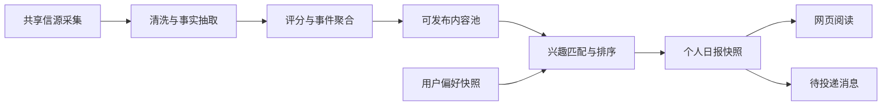
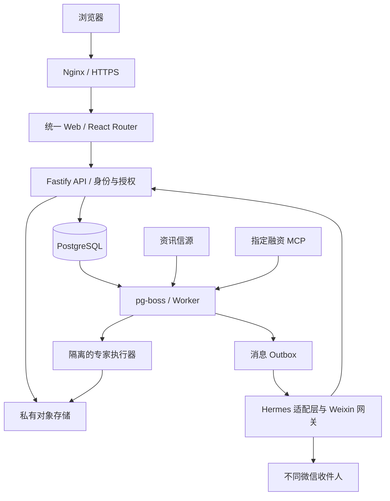

# 资讯与专家平台建设计划

版本：v0.1 · 日期：2026-10-21（Asia/Singapore）

状态：需求讨论稿，供逐项修改；本文中的技术选型、规模、时间和阈值均为建议。

仓库：[JoeLiaoo/newsfeed-fixedagent](https://github.com/JoeLiaoo/newsfeed-fixedagent)

## 1. 产品目标与已确认需求

建设一个统一品牌、统一账号、统一交互风格的平台，首页提供两个主要入口：

1. **个性化资讯**：基于 [AIHOT](https://github.com/KKKKhazix/AIHOT) 的引擎，用户选择关注方向，阅读相关资讯及个人日报。
2. **专家平台**：提供多个执行固定任务的专家，每个专家由 skill、MCP、workflow 和 prompt 共同定义，用户提交材料后获得可下载的产物。

同时在火山云 `ai-work` 实例运行 [Hermes Agent](https://github.com/NousResearch/hermes-agent)，向不同微信用户分别推送：

- 用户在网页选择的关注方向对应的个性化日报。
- 用户自行订阅的方向对应的最新融资信息，事实来源为用户后续指定的数据 MCP。

网页账号、兴趣配置、微信收件人和产物归属使用同一用户身份关联。平台需要持续运行，并能查看任务和推送的成功、失败与费用。

**本轮交付范围**：提交建设计划到仓库，后续讨论修改后再实施。现有实例正在运行其他内容，用户正在自行备份；备份完成、迁移范围及切换时间确认后，进入服务器变更阶段。

## 2. 首版范围与产品原则

### 2.1 建议的第一版

| 模块 | 第一版交付 | 后续扩展 |
|---|---|---|
| 统一门户 | 两个入口、统一导航、账号和设置、手机适配 | 工作台个性化、团队空间 |
| 资讯 | 公共资讯池、方向订阅、事件列表、个人日报、来源链接 | 更复杂的推荐、多语言、行业专题 |
| 专家 | 专家目录、表单和材料上传、异步执行、任务记录、产物下载；先验证 2–3 个专家 | 按注册规范扩充专家、审批工作流 |
| 微信 | 绑定、按用户定向发送、日报及融资两类独立开关、退订、发送记录 | 多渠道、用户通过消息修改订阅 |
| 融资 | 一个指定 MCP、标准化事件、按兴趣匹配、去重及增量提醒 | 多个数据源、企业关联图谱 |
| 后台 | 信源、分类、专家版本、任务、绑定和推送状态、配额及费用 | 团队管理、细化经营分析 |

建议先面向受邀用户试运行；第一版不涉及收费、专家市场、用户任意安装 skill/MCP 或任意执行代码。它们可在核心流程稳定后单独规划。

### 2.2 产品原则

- 资讯先形成共享事实和事件，再按用户兴趣筛选与编排，控制重复采集及模型费用。
- 网页浏览读取已经生成的结果，耗时的采集、模型调用、文件生成放入后台任务。
- 固定专家具有明确输入、步骤、工具权限、输出格式及验收规则，版本可追踪。
- 关注方向在网页中统一维护；资讯和融资订阅可以独立调整。
- 发送对象由服务端已验证的绑定决定，推送内容可回溯到具体事实和生成版本。
- 缺失数据保留为空并说明来源状态；模型不得补写融资金额、轮次、投资方等事实。

## 3. 已核对的上游能力与差距

核对日期为 2026-10-21。以下是资料核对结果；实际部署仍需在锁定版本上完成验证。

### 3.1 AIHOT

参考：[README](https://github.com/KKKKhazix/AIHOT/blob/main/README.md)、[架构](https://github.com/KKKKhazix/AIHOT/blob/main/docs/architecture.md)、[部署配置](https://github.com/KKKKhazix/AIHOT/blob/main/docker-compose.yml)。

| 已有能力 | 本项目的处理 |
|---|---|
| 多类型信源、预筛和评分、摘要、事件聚合、热度与日报 | 复用资讯引擎，保留原文证据及撤回规则 |
| 主题分类、公开 API、RSS、MCP 出口 | 支持网页、专家和日报读取同一份公开内容 |
| Node.js 24、TypeScript、React Router、Fastify、PostgreSQL、pg-boss | 优先延续这一技术栈，减少额外框架和队列 |
| web、api、worker 三个主要进程，以及模块扩展机制 | 在既有模块边界上扩展门户、账号、订阅和专家 |
| 公共内容匿名读取，收藏和阅读设置主要保存在浏览器 | 新增服务端用户、兴趣、收藏和订阅，支持跨设备同步 |

AIHOT 的原有日报面向站点内容；按账户生成日报、微信绑定、多用户投递和专家任务属于新增能力。其示范信源不能视为完整业务信源库。代码为 MIT 许可；引入源码需保留许可和 NOTICE，品牌及 Logo 使用本项目自己的设计。[许可说明](https://github.com/KKKKhazix/AIHOT/blob/main/README.md#许可)

### 3.2 Hermes Agent

参考：[README](https://github.com/NousResearch/hermes-agent/blob/main/README.md)、[Weixin 适配器](https://hermes-agent.nousresearch.com/docs/user-guide/messaging/weixin)、[MCP](https://hermes-agent.nousresearch.com/docs/user-guide/features/mcp)、[定时任务](https://hermes-agent.nousresearch.com/docs/user-guide/features/cron)、[Profiles](https://hermes-agent.nousresearch.com/docs/user-guide/profiles)。

- 已提供 skills、MCP 接入、定时任务和消息网关，可在 Linux 服务器运行。
- 当前官方文档已有 Weixin／iLink 适配器，优先验证这一接入方式。连接通过长轮询建立；本项目仍需为网页提供 HTTPS。
- 扫码关联的是 iLink 机器人身份。普通微信群接收能力存在限制，本计划按微信用户私聊投递设计。
- 发送依赖账号和收件人的会话状态。官方故障说明包括过期上下文导致发送失败，以及需要用户先发消息或重新配对的情况；连续主动推送能力需要用真实账户验证。
- 官方 Profiles 支持拆分配置、技能、记忆和运行状态。会话分离与完整用户数据隔离需要分别验证。
- Hermes 的默认主页收件人配置不能代替本项目的多用户收件人映射。

**源码观察点**：AIHOT `a0d1e75b00ede7e503ca948e71a468db964b2df2`；Hermes `cf4f3a7396814ffcaef69d9af09f7cfdade3ddbe`。这两个 SHA 用于追溯本次调研；实施时重新选择经过验证的发布版本或提交，记录依赖锁定和升级步骤。

## 4. 用户、页面与统一体验

### 4.1 角色

- **普通用户**：维护个人关注方向、阅读、使用专家、下载自己的文件、绑定微信及管理订阅。
- **运营管理员**：维护信源、分类、专家发布版本、运行配额、失败任务和推送状态。
- **系统服务**：采集、编排、调用 MCP、生成产物和投递消息；使用独立服务凭据及最小权限。

建议首版采用邀请注册及邮件验证登录，管理员采用额外认证保护；具体登录渠道在下一轮确定。网页登录与微信推送绑定独立实现。

### 4.2 页面结构

| 路径建议 | 内容及主要操作 |
|---|---|
| `/` | 统一首页，突出“个性化资讯”和“专家平台”两个入口 |
| `/news` | 我的关注、全部精选、热点、分类筛选、搜索 |
| `/news/events/:id` | 事件摘要、原文来源、发布时间及后续进展 |
| `/news/daily` | 我的日报、历史日报、日期切换 |
| `/experts` | 专家列表、分类、适用场景、输入和输出说明 |
| `/experts/:slug` | 任务表单、材料上传、样例产物及预计耗时 |
| `/tasks/:id` | 当前步骤、结果、错误提示、重试和产物下载 |
| `/settings/interests` | 资讯与融资方向、关键词、排除词及地域等条件 |
| `/settings/notifications` | 微信绑定、两类订阅、时间、时区、频率及暂停 |
| `/account/artifacts` | 个人任务记录与产物库 |
| `/admin` | 运营配置、任务、费用及运行状态 |

路由为规划值；落地时处理 AIHOT 原有路径、公开 API 和历史链接的兼容，保留必要重定向。

### 4.3 设计规范与状态

确定一个暂定品牌名后，共用颜色、字体、间距、按钮、表单、卡片和提示组件。桌面端以导航栏和侧栏组织内容，手机端采用紧凑导航。专家页面面向业务用户展示任务进度和结果，运行日志、MCP 细节放入管理界面。

覆盖首次使用、空列表、暂无匹配、加载、失败、部分完成、文件过期和渠道失效等状态。首次进入时选择方向；未绑定微信仍能在网页使用全部已授权功能。所有表单支持键盘操作，长任务离开页面后仍持续执行。

## 5. 个性化资讯与日报

### 5.1 兴趣模型

使用分层方向，例如 AI → 智能体／基础模型／AI 应用；可扩展至具备信源覆盖的其他行业。用户可选择方向、公司、关键词、排除词、语言和地域，首版以明确选择为主要依据。

分别保存 `news_preferences` 与 `funding_preferences`。首次可复制资讯兴趣作为融资兴趣，之后独立维护；记录偏好版本及生效时间，下一次生成使用新版本。

### 5.2 处理流程



先按明确分类、公司及关键词召回，再结合质量、时效和匹配度排序；需要时使用向量召回并通过样本评估收益。事件级去重、栏目多样性和排除词具有明确规则，用户能看到简短的匹配理由。

个人日报包含日期、统计窗口、栏目、事件摘要、来源链接和生成时间。建议每日 5–15 条，按用户选择的本地时间发送；示例默认 08:30，时区初始为 Asia/Singapore，可修改。无匹配时网页说明当期无新增，默认跳过空消息；用户可选择接收空日报通知。

首版优先复用已生成摘要并确定性编排；模型只对需要的导读或压缩内容增量生成。同一事实的公共摘要可共享，个人导读缓存必须按用户和偏好版本隔离。兴趣超出信源覆盖时在设置页提示覆盖情况。

采用“上次成功日报截止点至本次截止点”的半开时间窗口，内部以 UTC 存储，保留用户时区和当地日历日期。任务重跑复用当期快照，用户主动重新生成时保留修订版本。发送前再次检查内容撤回状态、用户绑定及退订状态。

## 6. 固定任务专家平台

### 6.1 专家定义

每个专家作为一个版本化能力包注册：

| 部分 | 内容 |
|---|---|
| Manifest | 专家 ID、名称、用途、版本、输入及输出 schema、允许角色、成本和超时上限 |
| Skill | 领域操作方法、样例、判断标准及步骤要求 |
| MCP | 指定连接器和允许工具、凭据范围、调用预算 |
| Workflow | 输入检查、资料获取、分析、生成、校验、导出的步骤及失败处理 |
| Prompt | 各步骤模板、引用要求、输出约束和缺失数据规则 |
| Renderer | Markdown、DOCX、PDF、XLSX、PPTX 等格式的导出实现，按专家实际需要选择 |
| Evaluation | 典型输入、预期行为、样例产物、人工验收标准 |

用户选择专家后提交结构化表单和材料；系统检查材料是否齐备，显示预计耗时及配额后创建任务。首版使用管理员发布的能力包，用户输入按业务数据处理，不能修改系统工具权限。

### 6.2 首批专家候选

以下为讨论候选，首批名单及模板需用户选择：

| 专家候选 | 输入 | 工作与输出 | 依赖 |
|---|---|---|---|
| 行业资讯简报专家 | 方向、时间范围、重点公司 | 基于资讯池生成带出处的简报；Markdown／PDF | 资讯读取接口 |
| 融资追踪报告专家 | 赛道、地域、轮次、日期 | 查询指定融资 MCP，形成事件表及概述；XLSX／PDF | 用户指定 MCP、数据授权 |
| 会议纪要专家 | 转写稿、时间、参与者和输出要求 | 提取议题、结论及待办；DOCX／Markdown | 转写稿、确认后的模板 |

先用一个专家跑通上传到下载的全链路，再扩展 2–3 个。新专家采用相同注册协议，后续可增加研究、报告、文书和数据整理等类别。

### 6.3 任务生命周期

`queued → validating → running → rendering → checking → succeeded`

异常状态包括 `waiting_input`、`failed`、`cancelled`、`timed_out`。补充材料后从明确检查点继续；任务结果包含输入摘要、步骤版本、引用、模型及 MCP 使用、费用和产物清单。

- 请求幂等键防止重复点击创建两次任务；步骤具有独立执行记录，已成功的付费调用尽量复用。
- 长任务使用租约与心跳，进程退出后可恢复；限制每用户并发和总并发。
- 取消时阻止新步骤并尽力终止当前子进程，已发生费用保留记录。
- 外部工具可重试的错误与材料错误分别处理；重试有次数及时间上限。
- 失败应指出可操作原因；部分产物明确标为草稿，完整验收后才显示任务成功。

### 6.4 产物与隔离

上传检查文件大小、扩展名、实际类型和可解析性，首版建议单文件上限 20 MB，可配置。材料和产物按用户及任务隔离，下载前鉴权，生成短期签名链接；微信中的个人日报链接同样需要登录确认归属。

优先使用私有对象存储，支持备份与生命周期。原始材料和产物的保留期建议分别为 7 天及 30 天，具体期限待定；用户可提前删除。下载失效时提示重新生成或续期。DOCX/PDF/PPTX 需检查实际打开及版式，XLSX 校验单元格类型和公式；产物列表记录格式、大小和校验和。

执行容器使用独立临时工作区、非 root 用户、CPU/内存/时长限制及允许访问的工具。生产密钥由执行端注入，禁止任务访问 Docker socket、宿主机私钥和其他用户文件。引用文档、网页及 MCP 输出视为待分析资料，不能据其内容扩大权限。

## 7. 融资数据与提醒

### 7.1 MCP 接入约定

融资事实使用用户指定的数据 MCP。当前名称、连接方式、授权、限流、费用、字段和更新周期尚未给出，因此先定义适配接口和样例数据，真实接入等待指定服务。

接入验证包括工具发现、鉴权、字段映射、时间范围查询、分页、增量游标、历史回补、纠错及数据展示/推送授权。平台内部建议提供 `search_funding_events` 和 `get_funding_event` 两类能力；最终工具名称以服务商提供的 schema 为准。

标准事件建议字段：`provider`、`provider_event_id`、公司 ID/名称、所属赛道、地域、轮次、金额原文、数值及币种（可空）、投资方、事件发生日期、对外披露时间、数据源更新时间、平台发现时间、来源链接、证据状态和修订版本。不同时间语义独立保存，日期精度不足时记录精度。

### 7.2 更新、匹配及推送

建议从每 60 分钟查询开始，根据 MCP 更新频率和价格调整，网页显示最近成功同步时间。“最新”按数据商披露及更新时间识别，提醒延迟由数据商、轮询、处理和渠道共同决定。

分页同步完成并持久化后推进游标；查询保留可配置重叠窗口，防止迟到数据漏收。优先用数据商事件 ID 去重，缺失时结合公司、轮次、日期及证据匹配；存在歧义的融资记录保留待核对。

事件归一化后按用户融资偏好匹配，支持赛道、轮次、地域、金额范围及公司。金额未披露时明确标注，金额筛选是否包含未知值由用户选择；不自动推算估值。无对应事实的说明只描述观察，避免生成投资建议。

融资提醒提供独立开关，建议默认每天一次汇总，可选工作时段增量提醒。首次接入先显示历史列表，从启用时间建立推送起点；历史回补默认不逐条发送。更正和撤回更新事件版本，必要时发更正说明；无新增不发送。

## 8. Hermes 与微信个性化投递

### 8.1 绑定流程

1. 用户登录网页，在通知设置中启动绑定，服务端生成短期、一次性随机码，例如 10 分钟有效。
2. 用户按页面指引联系服务机器人并发送绑定码；由网关取得真实平台收件人 ID。
3. 服务端验证绑定码和网页身份，展示待绑定状态，并由用户确认绑定及两类订阅。
4. 建立 `user_id ↔ channel_account_id ↔ recipient_id` 映射，随后进行一条用户触发的连通性测试。
5. 用户可以查看绑定状态、暂停某一类消息或解绑。解绑后撤销尚未开始投递的任务，发送前检查最新状态。

绑定码只保存哈希，限制尝试次数；不接受用户直接输入收件人 ID 来完成绑定。默认一个网页账号对应一个有效微信绑定，多个账号争用同一收件人时进入明确的解绑重绑流程。

### 8.2 运行分工及可靠性

平台数据库是偏好、订阅、调度和收件人映射的唯一业务依据。平台 worker 负责生成待投递记录；部署在 ai-work 的 Hermes 负责受限的内容编排能力和 Weixin 网关接入，投递适配层对接其发送能力。

推荐使用已有 pg-boss 管理业务调度，Hermes 的定时能力用于有限的唤醒或运维任务。每个业务计划只有一个调度所有者，避免 pg-boss 与 Hermes cron 重复创建日报或重复发送。具体调用 Hermes 的方式需先验证锁定版本的 CLI/插件/内部适配接口，本文不假定已有公开任务 API。

- 日报和融资生成分别产生持久化 outbox，再由发送执行器领取；内容生成与投递故障能够独立恢复。
- 幂等身份包括用户、消息类型、日报日期或融资事件版本、渠道及绑定版本。
- 记录 `pending / sending / accepted / failed / unknown / cancelled / requires_rebind`，保存重试次数及下一次处理时间。
- `accepted` 表示渠道接口受理；没有相应回执时，用户送达及阅读状态记为未知。
- 网络超时且渠道可能已接受时进入 `unknown`，查询可用回执或人工处理，避免盲目重发；跨外部渠道不承诺绝对只发送一次。
- 发送前后记录载荷哈希和渠道消息 ID；明确可重试失败采用退避、次数上限和死信处理。
- 渠道会话失效时转为需重新绑定或激活，在网页提示；渠道恢复后仅补发有效且用户仍需要的消息，防止积压刷屏。
- 融资提醒遵守静默时间、条数及频率上限；长内容发送摘要和网页链接，消息分片由适配层处理。

### 8.3 多用户状态隔离

消息网关采用受限服务身份，读取已生成的当前收件人载荷。禁止把不同用户偏好、材料及日报写入共享的个人长期记忆。固定任务调用使用按用户/任务隔离的运行目录和状态，工具由服务端授权绑定用户身份，模型不能通过参数切换账户。

若采用 Hermes Profile 隔离，要验证 profile、记忆、会话、MCP 凭据及工作目录的实际作用域；单一 Profile 内多个聊天不作为完整隔离依据。同一个 Weixin token 只运行一个轮询网关，不给每个网页用户复制网关 token。用户任务与共用网关通过受控适配层协作。

### 8.4 微信前置验证

用至少两个真实测试用户验证绑定、定向消息、两类不同偏好、跨日定时发送、重启后投递、过期会话、退订、长消息及限流。优先验证官方 Weixin／iLink 方案；社区桥接仅在单独评估后考虑。

如实测无法满足长期主动提醒，则将微信投递列为受阻项，保留网页日报和待投递记录；再与用户确定具备相应权限的替代渠道。公众号、企业微信等渠道需要独立核对账号资质、接口规则和可达用户范围，不能直接替换并承诺等价体验。

## 9. 技术架构与代码组织

### 9.1 建议架构



保留 AIHOT web/api/worker 主体与 PostgreSQL。新增模块优先使用其模块插口；身份校验和公开/私人读取边界需要显式扩展。Hermes 为独立 Python 运行环境，通过有限的契约与平台协作。首版无需引入 Kubernetes、额外向量数据库或第二套业务队列。

专家执行器使用独立接口，先验证 Hermes 对固定任务、工具权限及隔离的适配程度；文档导出由专门 renderer 完成。若某一步适合确定性脚本，可直接作为工作流步骤运行，统一记录版本和输出。

### 9.2 数据实体建议

| 实体组 | 核心对象 |
|---|---|
| 账号 | users、sessions、roles、invitations |
| 兴趣 | topics、user_preferences、preference_versions |
| 资讯 | 复用 AIHOT 的来源、文章、事件及发布结果；新增 personal_digests、digest_items |
| 融资 | funding_sources、funding_events、funding_revisions、sync_cursors |
| 专家 | expert_definitions、expert_versions、task_runs、task_steps、uploads、artifacts |
| 投递 | channel_bindings、subscriptions、notification_outbox、delivery_attempts |
| 运营 | usage_ledger、audit_logs、system_settings |

私人对象均明确 `owner_user_id`；所有列表、详情、下载及任务工具检查归属。公共内容与用户材料分别读取，禁止通过公共 API/MCP 暴露私人日报和产物。定时唯一键、任务幂等键、事件去重及索引在数据库层落实。

### 9.3 关键接口建议

- `GET/PATCH /api/me/preferences`：读写兴趣及版本。
- `GET /api/me/digests`、`GET /api/me/digests/:id`：读取自己的日报。
- `POST /api/me/channel-binding/start`、`POST /api/me/channel-binding/confirm`：绑定启动和确认。
- `PATCH /api/me/subscriptions`：两类消息、频率、时区和暂停。
- `GET /api/experts`、`POST /api/tasks`、`GET /api/tasks/:id`：选择专家及运行任务。
- `POST /api/uploads`、`GET /api/artifacts/:id/download`：材料及产物。
- 内部 MCP／服务接口：受限读取资讯、领取当前任务、提交结果和处理绑定消息。

接口名称为设计草案；实施时生成 schema，覆盖身份、分页、幂等键、错误码和限流。内部接口使用服务认证和窄权限，来源网络限制作为补充。

### 9.4 仓库组织建议

```text
apps/{web,api,worker}/       # 基于 AIHOT 的主体
packages/{backend,contracts}/
modules/{identity,personalization,experts,funding,notifications}/
experts/<expert-id>/        # manifest、skill、workflow、prompts、样例
services/hermes-adapter/    # 独立运行环境与平台契约
database/migrations/
site/                      # 统一品牌与界面配置
industry/                  # 分类、信源及精选要求
deploy/                    # Compose、反向代理与运维文档
docs/                      # 后续拆分的设计和操作说明
PLAN.md                    # 本计划
```

实施时将选定 AIHOT 源码和许可导入本仓库，记录上游基线与本地修改清单，保持模块化以便合并上游更新。Hermes 优先以固定版本依赖或构建镜像管理，保留版本清单。密钥、`.env`、微信凭据、用户材料和生成文件进入忽略规则及私有存储。

## 10. ai-work 部署与运维

### 10.1 部署前条件

当前已确认 SSH 可连接、实例运行 Ubuntu、Nginx 活跃且存在 `ai-work-mvp` 站点配置。CPU、内存、磁盘容量、其他服务、数据库、端口和备份完整性仍需盘点，不能根据 Nginx 状态推断实例上的全部业务。

实施前确认用户备份完成，保存服务清单、反向代理配置、应用配置、数据库和文件快照，并实际验证可恢复。部署采用独立项目目录、网络及卷；切换前先在独立内部端口验证，切换后保留回退路径。需要重装实例时另行确认系统盘与数据盘的处置范围。

### 10.2 建议服务及资源

Docker Compose 管理 web、api、worker、数据库和 Hermes／执行器运行环境。现有 Nginx 可继续统一接入，避免与 AIHOT 可选 Caddy 同时占用 80/443。数据库和管理端口不直接对公网开放，内部应用端口仅限容器网络或本机访问。

初始容量假设：受邀用户 20–50 人、并发专家任务 1–2 个、使用外部模型 API。建议试运行评估基线为 4 vCPU、8 GB RAM、80 GB SSD；此为容量建议，需要与实际实例规格和压测结果核对。浏览器抓取、文档渲染及多个 Hermes 进程可能需要更多内存，必要时分离专家执行器。

正式登录和微信访问网页前配置域名及 HTTPS；公网 IP 用于运维和早期连通检查。域名、实例所在区域和相关上线要求在实施前核对。模型、信源、MCP 和 iLink 的出站连通性分别验证。

### 10.3 发布、恢复及监控

- 本地开发和生产使用不同数据库、凭据及对象存储前缀，测试发送只面向明确测试账户。
- 代码变更经检查后构建固定镜像；发布前备份并执行数据库迁移，应用通过健康检查后切换。
- 保留前一版本镜像及配置；涉及数据结构的回滚先明确兼容性，避免直接回退破坏数据。
- 建议数据库每日备份、文件及配置按计划备份到实例之外，备份加密。试运行目标 RPO 24 小时、RTO 4 小时，通过恢复演练验证后再对外承诺。
- 观察采集成功率、源更新延迟、MCP 同步时间、队列等待、专家成功率、渲染耗时、投递状态、渠道过期、磁盘和模型费用。
- 日志以用户 ID、任务 ID 和消息 ID 关联，敏感正文和凭据脱敏。重大失败、积压及预算熔断通知管理员，连续相同故障合并告警。

## 11. 质量、权限和费用

### 11.1 验收建议

| 领域 | 首版验收条件 |
|---|---|
| 统一体验 | 两个入口可达；账号、导航、表单和移动端风格一致；空态和错误态可操作 |
| 个性化 | A/B 两个用户选择不同方向，分别得到对应内容；修改偏好后下一期生效 |
| 日报 | 窗口及时区正确；每条新闻有来源；相同事件当期只出现一次；重跑记录清晰 |
| 融资 | 金额、币种、轮次、投资方逐字段对照 MCP；分页、迟到、更正及历史回补不漏不刷屏 |
| 专家 | 2–3 个已确认专家各有代表性样例；建议每个至少 10 个案例，关键事实及格式符合模板 |
| 下载 | 产物能打开；材料和产物访问遵守归属；过期和删除正确生效 |
| 微信 | 两名以上真实用户连续跨日至少 3 天验证；两类内容分别匹配；退订后待发消息取消 |
| 故障 | 验证 worker/网关重启、MCP 超时、渠道失效及不确定发送结果；无未经核对的重复补发 |
| 权限 | 用户 A 无法通过 ID、链接、工具或任务访问 B 的材料、日报和产物；日志无凭据 |
| 运维 | 备份恢复演练完成；发布回滚可执行；预算和并发上限生效 |

建议资讯匹配采用人工标注集检查，例如 50–100 条样本、相关性通过率目标 85%，再用真实试用反馈修订。融资金额等关键字段要求与源数据一致；模型评审作为辅助，关键案例由人工核对。上述阈值均为试运行目标，需要在范围确定后冻结。

### 11.2 成本模型

月成本由实例、数据库与文件备份、域名、模型、信源、融资 MCP 和渠道费用组成。现有实例是否需要扩容、MCP 是否按查询收费尚未确定，本阶段不提供未经核对的价格。

模型预算按“共享资讯处理条数 × 单条成本 + 个人导读调用 + 专家任务步骤调用”估算；MCP 按共享同步次数及专家查询估算，优先在授权允许范围内共享已获取事实。每次调用记录用量和供应商返回值，失败及重复请求也纳入账本。

设置全站日/月预算、每用户日配额、每专家成本上限和供应商限流；达到上限时暂停新增付费步骤并提示，已生成内容仍可访问。供应商数据是否允许缓存和跨用户分发必须以实际合同/授权为准。

## 12. 实施阶段、交付物与依赖

工作日估算按一名主要开发者推进，依赖材料和账户及时到位。以下约 25–40 个开发工作日作为讨论基线；实际以第一阶段验证结果重新估算，外部账号和数据授权等待另计。

| 阶段 | 估算 | 工作与交付 | 完成条件 |
|---|---|---|---|
| P0 需求及可行性 | 3–5 日 | 修改本计划；确认用户、专家、MCP、预算；只读盘点实例；验证 Weixin 与融资源 | 两个测试用户的主动投递有证据；MCP 返回真实字段；阻碍明确 |
| P1 基础与资讯 | 5–8 日 | 引入 AIHOT、品牌和双入口、账号权限、信源及兴趣设置、个人日报 | 网页中 A/B 用户看到各自日报，来源可追溯 |
| P2 专家执行 | 6–9 日 | 能力包注册、上传、队列、隔离执行、renderer、下载与任务记录 | 首个专家全链路完成，再扩展到已选 2–3 个 |
| P3 融资及微信 | 6–10 日 | MCP 增量同步、偏好匹配、绑定、Hermes 投递适配、outbox 与退订 | 两类消息定向发送；重试、更正和渠道失效可处理 |
| P4 上线与试运行 | 5–8 日 | HTTPS、资源调优、备份恢复、回滚、质量样例、监控和操作文档 | 连续试用通过验收，旧服务迁移及切换完成 |

依赖关系：P0 完成关键渠道及数据验证后，P1 提供账号和偏好底座；P2、P3 依赖底座，P4 依赖关键链路完成。微信和 MCP 的试验在 P0 启动，避免推迟到上线阶段。

各阶段具体待办：

- [ ] P0：确认计划版本、用户规模、首批方向与专家；确定融资 MCP 和微信测试账户。
- [ ] P0：确认备份及现有服务迁移范围；记录硬件规格、占用及出站连通情况。
- [ ] P0：验证官方 Weixin 的跨用户和跨日主动发送，记录限制及替代方案决策。
- [ ] P1：导入锁定的 AIHOT 基线和许可，配置项目忽略规则、示例环境变量及开发说明。
- [ ] P1：完成统一页面壳、认证、兴趣设置、私有日报和基础管理权限。
- [ ] P2：冻结首个专家的输入、样例、模板及步骤；实现任务与下载，再扩充专家。
- [ ] P3：冻结融资字段映射、游标和纠错规则，完成两类订阅与可靠投递。
- [ ] P4：补齐上线清单、恢复演练、真实试用记录和运营手册。

## 13. 待讨论决策

以下项目在本轮计划中保留为待定，不阻止提交讨论稿：

| 编号 | 需要确定的内容 | 当前建议／影响 |
|---|---|---|
| D01 | 平台名称、Logo、视觉偏好 | 先建立统一设计规范，品牌名后定 |
| D02 | 受邀内部使用还是面向公众；首批人数 | 建议先 20–50 位受邀用户，影响登录及资源 |
| D03 | 首批资讯方向、公司和必要信源 | 决定 AIHOT 行业包与内容覆盖，避免空订阅 |
| D04 | 首批 2–3 位专家及各自产物模板 | 必须有真实任务和合格样例，决定开发量 |
| D05 | 指定融资 MCP 的名称、地址及授权 | 决定事实字段、更新频率、成本与展示范围 |
| D06 | 微信测试账户与最终接入方式 | 优先官方 Weixin，跨日主动投递实测后冻结 |
| D07 | 日报时间、融资提醒频率及静默时段 | 建议日报 08:30、融资默认每日汇总，用户可改 |
| D08 | 登录渠道、域名及邀请规则 | 建议邀请注册，微信单独绑定 |
| D09 | 模型提供商及全站/每用户预算 | 需同时满足资讯和专家任务的质量与费用 |
| D10 | 用户材料、产物保留期及共享范围 | 建议默认私有；保留期和备份策略一起确认 |
| D11 | ai-work 备份完成时间、保留业务及切换窗口 | 决定原地迁移、停机切换或重装范围 |

下一轮建议先讨论 D03、D04、D05 和 D06，以确定内容覆盖、专家范围以及微信和数据链路。修改本文件并递增版本，记录决策原因；实施前将稳定部分拆为产品需求、技术设计和部署手册。

## 14. 资料与版本记录

主要依据为用户本次需求及上游官方资料：

1. [AIHOT 仓库及 README](https://github.com/KKKKhazix/AIHOT)，采集、精选、日报及许可说明。
2. [AIHOT 架构](https://github.com/KKKKhazix/AIHOT/blob/a0d1e75b00ede7e503ca948e71a468db964b2df2/docs/architecture.md)，进程、模块、公开读取边界。
3. [AIHOT Docker Compose](https://github.com/KKKKhazix/AIHOT/blob/a0d1e75b00ede7e503ca948e71a468db964b2df2/docker-compose.yml)，服务与持久化结构。
4. [Hermes Agent](https://github.com/NousResearch/hermes-agent)，官方 agent 项目。
5. [Hermes Weixin 文档源码](https://github.com/NousResearch/hermes-agent/blob/cf4f3a7396814ffcaef69d9af09f7cfdade3ddbe/website/docs/user-guide/messaging/weixin.md)，绑定、会话状态和发送约束。
6. [Hermes MCP](https://hermes-agent.nousresearch.com/docs/user-guide/features/mcp)，本地和远程工具接入。
7. [Hermes 定时任务](https://hermes-agent.nousresearch.com/docs/user-guide/features/cron)，调度与投递能力。
8. [Hermes Profiles](https://hermes-agent.nousresearch.com/docs/user-guide/profiles)，配置、状态与记忆的作用域。

官方资料描述上游能力；本计划中的账号模型、个性化算法、任务协议、适配层、预算、容量及阶段安排是本项目的设计建议。资料更新后需重新核对，不把上游功能描述视为本项目已实现。

| 版本 | 日期 | 变更 |
|---|---|---|
| v0.1 | 2026-10-21 | 根据首次需求建立整体计划，补充上游核对、待定决策及验收条件 |
