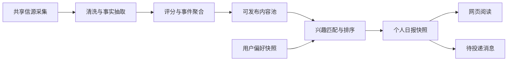
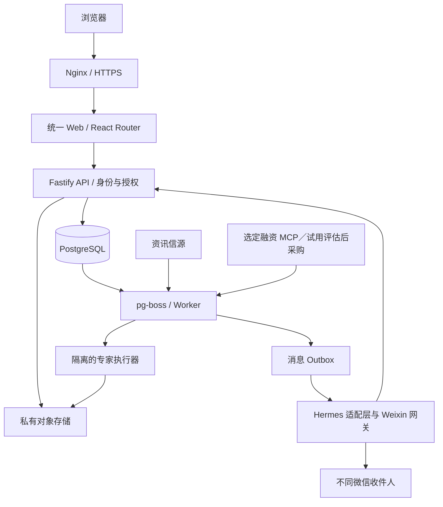

# 中信私募ai平台建设计划

版本：v0.69 · 日期：2026-10-23（Asia/Shanghai）

状态：需求讨论稿，供逐项修改；本文中的技术选型、规模、时间和阈值均为建议。

仓库：[JoeLiaoo/newsfeed-fixedagent](https://github.com/JoeLiaoo/newsfeed-fixedagent)

## 1. 产品目标与已确认需求

建设一个统一品牌、统一账号、统一交互风格的平台。员工登录后首页直接展示当天的个人日报，持续更新的新闻列表与专家平台通过全站导航进入。平台包含两项主要能力：

1. **个性化资讯**：基于 [AIHOT](https://github.com/KKKKhazix/AIHOT) 的引擎，用户从投资部门对应的方向中自行选择关注领域，阅读相关资讯及个人日报。
2. **专家平台**：首个专家基于 `reference/SKILL.md` 中的“单体分析09-对外投资全景图核查”建立，首版必须有该专家；其复杂规则与产物可在上线后继续联调。平台支持用户上传 ZIP 包或单独的 `SKILL.md` 创建更多专家；格式及安全检查通过后自动公开，供所有用户使用。专家任务调用 DeepSeek API，用户提交材料后获得可下载的产物。包结构及可用工具范围待确定。

同时在火山云 `ai-work` 实例运行 [Hermes Agent](https://github.com/NousResearch/hermes-agent)，向不同员工的个人微信账号分别推送：

- 用户在网页选择的关注方向对应的个性化日报。
- 管理员预置的 GP 新增投资了哪些企业；按被投企业所属细分赛道匹配用户的关注方向，每天向匹配用户汇总一次。候选数据源包括悟道、企查查、新华财经等 MCP 试用账号，正式来源以能力验证和实际采购为准。

网页账号、兴趣配置、微信收件人和产物归属使用同一用户身份关联。平台需要持续运行，并能查看任务和推送的成功、失败与费用。

**当前开发范围**：按 [分步骤实施计划](IMPLEMENTATION.md) 推进 P0–P4，先使用已提供的 DeepSeek API 与新华财经 MCP；其他 MCP 仍作为后续采购和接入候选。旧版 `ai-work-mvp` 已按用户决定在火山云同机归档留存，不要求旧版异地备份或恢复演练；保留 `ai-work` 操作系统。新平台自身的备份恢复按运维要求验收，旧组件退役前明确操作范围和共享服务影响。

## 2. 首版范围与产品原则

### 2.1 建议的第一版

| 模块 | 第一版交付 | 后续扩展 |
|---|---|---|
| 统一门户 | 登录后直接展示当天个人日报、全站导航可进入实时资讯与专家平台、统一账号和设置、手机适配 | 工作台个性化、团队空间 |
| 资讯 | 公共资讯池、员工添加网站或 RSS 信源、方向订阅、事件列表、个人日报、来源链接 | 更复杂的推荐、多语言、行业专题 |
| 专家 | 内置基于 `reference/SKILL.md` 的“单体分析09-对外投资全景图核查”专家；用户也可上传 ZIP 包或 `SKILL.md` 创建专家，校验通过即公开；提供目录、表单和材料上传、异步执行、任务记录、产物下载 | 首个专家的复杂规则和产物质量继续联调；按注册规范扩充专家、版本管理 |
| 个人微信 | 管理员已批准注册的用户均可从「我的 → 微信通知」获取个人专属的短期 iLink 二维码，微信扫码确认后网站自动绑定；不需手动网页绑定码或网页二次确认。新账号默认开启新闻与 GP 订阅，用户可分别关闭；因渠道发送窗口限制，必要时员工主动向 bot 发送一条消息恢复推送。聊天权限仍独立管理 | 多渠道、用户通过消息修改订阅 |
| GP 投资动向 | 管理员维护 GP 名单；评估悟道、企查查、新华财经等试用 MCP，跟踪名单内 GP 的新增投资，按被投企业赛道匹配用户并每日汇总 | 多数据源融合、企业关联图谱 |
| 后台 | 信源、分类、专家版本、任务、绑定和推送状态、配额及费用 | 团队管理、细化经营分析 |

首版仅供本公司约 20 名员工使用；第一版不涉及收费和专家市场。用户可上传 ZIP 包或单独的 `SKILL.md` 创建专家，通过格式及安全检查后自动公开。专家只能调用平台已接入并授权的 MCP，上传者不能通过能力包自行接入 MCP；包内允许的 skill、workflow、prompt 及可执行内容范围，须在确定包格式与隔离规则后冻结。

### 2.2 产品原则

- 资讯先形成共享事实和事件，再按用户兴趣筛选与编排，控制重复采集及模型费用。
- 网页浏览读取已经生成的结果，耗时的采集、模型调用、文件生成放入后台任务。
- 固定专家具有明确输入、步骤、工具权限、输出格式及验收规则，版本可追踪。
- 用户在网页维护细分赛道关注；新闻和 GP 新增投资均据此匹配。管理员维护被监测的 GP 名单；新闻推送与 GP 投资动向汇总分别控制订阅开关。
- 发送对象由服务端已验证的绑定决定，推送内容可回溯到具体事实和生成版本。
- 缺失数据保留为空并说明来源状态；模型不得补写融资金额、轮次、投资方等事实。

## 3. 已核对的上游能力与差距

核对日期为 2026-10-21。以下是资料核对结果；实际部署仍需在锁定版本上完成验证。

### 3.1 AIHOT

参考：[README](https://github.com/KKKKhazix/AIHOT/blob/main/README.md)、[架构](https://github.com/KKKKhazix/AIHOT/blob/main/docs/architecture.md)、[部署配置](https://github.com/KKKKhazix/AIHOT/blob/main/docker-compose.yml)。

| 已有能力 | 本项目的处理 |
|---|---|
| 多类型信源、预筛和评分、摘要、事件聚合、热度与日报 | 复用资讯引擎，保留原文证据及撤回规则 |
| 主题分类、公开 API、RSS、MCP 出口 | 支持网页、专家和日报读取同一份公开内容 |
| Node.js 24、TypeScript、React Router、Fastify、PostgreSQL、pg-boss | 优先延续这一技术栈，减少额外框架和队列 |
| web、api、worker 三个主要进程，以及模块扩展机制 | 在既有模块边界上扩展门户、账号、订阅和专家 |
| 公共内容匿名读取，收藏和阅读设置主要保存在浏览器 | 新增服务端用户、兴趣、收藏和订阅，支持跨设备同步 |

AIHOT 的原有日报面向站点内容；按账户生成日报、微信绑定、多用户投递和专家任务属于新增能力。其示范信源不能视为完整业务信源库。代码为 MIT 许可；引入源码需保留许可和 NOTICE，界面采用浅色风格并少量露出红色，平台不放 Logo。[许可说明](https://github.com/KKKKhazix/AIHOT/blob/main/README.md#许可)

### 3.2 Hermes Agent

参考：[README](https://github.com/NousResearch/hermes-agent/blob/main/README.md)、[Weixin 适配器](https://hermes-agent.nousresearch.com/docs/user-guide/messaging/weixin)、[MCP](https://hermes-agent.nousresearch.com/docs/user-guide/features/mcp)、[定时任务](https://hermes-agent.nousresearch.com/docs/user-guide/features/cron)、[Profiles](https://hermes-agent.nousresearch.com/docs/user-guide/profiles)。

- 已提供 skills、MCP 接入、定时任务和消息网关，可在 Linux 服务器运行。
- 当前官方文档已有 Weixin／iLink 适配器，优先验证这一接入方式。连接通过长轮询建立；本项目仍需为网页提供 HTTPS。
- Hermes 接入时的 iLink 登录二维码只供管理员将机器人身份连接到网关，绝不展示给员工或用作个人账号绑定。仅网页登录状态为管理员已批准的员工可以打开微信绑定页；员工扫描经过验证的机器人联系人／会话入口二维码后，通过一次性绑定挑战把可信的微信收件人身份关联到当前网页登录账号，不能仅凭二维码内容或浏览器提交的收件人 ID 认定绑定成功。
- 微信绑定与机器人聊天授权分离：绑定挑战须在 Hermes 的 pairing 管理员审批门之前被安全识别和处理，只允许完成平台账号绑定，不开放普通对话或 Agent 工具；员工可以接收个人订阅推送。只有管理员另行批准该用户的 Hermes 私聊配对后，普通聊天才开放。
- 新建订阅设置默认 `news_enabled=true`、`gp_enabled=true`、`paused_until=null`。用户首次绑定后即可接收所关注赛道的资讯和 GP 推送；用户可以分别退订或暂停。重新绑定不得覆盖用户已有的订阅选择。
- 个人微信聊天和订阅推送均经同一个 Hermes 私聊会话；群聊不在首版范围。绑定挑战应在 Hermes 入站适配中安全识别，避免把挑战码交给普通 Agent 回答；对话本身继续由 Hermes 处理。
- 本项目优先验证每个已批准员工使用个人专属 iLink 登录二维码，扫码确认后自动关联；现行 Hermes 单账号限制须经双用户 PoC 验证或增设独立 channel manager。详见 [P3 独立扫码设计](P3-ILINK-QR-DESIGN.md)。
- 发送依赖账号和收件人的会话状态。官方故障说明包括过期上下文导致发送失败，以及需要用户先发消息或重新配对的情况；连续主动推送能力需要用真实账户验证。
- 官方 Profiles 支持拆分配置、技能、记忆和运行状态。会话分离与完整用户数据隔离需要分别验证。
- Hermes 的默认主页收件人配置不能代替本项目的多用户收件人映射。

**源码观察点**：AIHOT `a0d1e75b00ede7e503ca948e71a468db964b2df2`；Hermes `cf4f3a7396814ffcaef69d9af09f7cfdade3ddbe`。这两个 SHA 用于追溯本次调研；实施时重新选择经过验证的发布版本或提交，记录依赖锁定和升级步骤。

## 4. 用户、页面与统一体验

### 4.1 角色

- **员工用户**：维护个人关注方向、添加网站或 RSS 新闻信源、阅读、使用专家、下载自己的文件、绑定微信及管理订阅。
- **运营管理员**：维护信源、分类、专家发布版本、运行配额、失败任务和推送状态。
- **系统服务**：采集、编排、调用 MCP、生成产物和投递消息；使用独立服务凭据及最小权限。

首版仅供本公司员工使用，不接入企业单点登录。任何人都可以访问注册页并以用户名、真实姓名和密码提交注册申请，不要求邮箱；新账号先处于待审核状态，由管理员自行判断是否批准，审核通过后才能登录使用。记录审核人、时间与结果；管理员自身采用额外认证保护。网页登录与微信推送绑定独立实现。

### 4.2 页面结构

| 路径建议 | 内容及主要操作 |
|---|---|
| `/` | 登录后展示当天个人日报；尚未生成时显示生成状态和最近一期日报；实时资讯与专家平台保留全站导航入口 |
| `/news` | 持续更新的新闻列表：我的关注、全部精选、热点、分类筛选、搜索 |
| `/news/events/:id` | 事件摘要、原文来源、发布时间及后续进展 |
| `/news/daily` | 我的日报历史、日期切换；当期日报也可从首页打开 |
| `/experts` | 专家列表、分类、适用场景、输入和输出说明 |
| `/experts/:slug` | 任务表单、材料上传、样例产物及预计耗时 |
| `/tasks/:id` | 当前步骤、结果、错误提示、重试和产物下载 |
| `/settings/interests` | 跨部门多选一级方向及其细分赛道，或自行添加细分赛道；所选赛道用于新闻及 GP 新增投资匹配 |
| `/settings/sources` | 员工提交网站或 RSS 新闻来源，查看来源状态和收录情况 |
| `/settings/notifications` | 已获准的平台用户扫描机器人联系人二维码绑定微信；新闻和 GP 推送默认开启且可分别退订。私聊机器人另由管理员审批；页面展示绑定状态、订阅开关及最近推送记录 |
| `/projects/invested-gp` | 已投 GP 直投项目清单 |
| `/projects/citic-alliance` | 中信股权联盟直投项目清单 |
| `/projects/market-leaders` | 市场头部机构直投项目清单 |
| `/knowledge` | 全公司共享投研知识库（构建与问答见 [Issue #27](https://github.com/JoeLiaoo/newsfeed-fixedagent/issues/27)） |
| `/account/artifacts` | 个人任务记录与产物库 |
| `/admin` | 运营配置、任务、费用及运行状态 |

路由为规划值；落地时处理 AIHOT 原有路径、公开 API 和历史链接的兼容，保留必要重定向。

### 4.3 设计规范与状态

平台名称确定为“中信私募ai平台”，界面不放 Logo，以文字呈现平台名称。视觉上可松散参考[中信投资控股官网](https://www.invest.citic/)的红色元素，但不要求严格遵循其色值或视觉规范；采用浅色背景，仅在关键操作、提示或局部装饰中露出少量红色，不把深色用作品牌色或大面积页面底色。正文使用保证可读性的中性文字色。统一首页、资讯、专家和设置页面的颜色、字体、间距、按钮、表单、卡片与提示组件。桌面端以导航栏和侧栏组织内容，手机端采用紧凑导航。左侧边栏固定为四个一级入口：资讯平台、专家平台、项目信息、知识库；资讯平台与项目信息是可展开的分组，深链直达子页时自动展开所在分组；功能尚未建好的页面只显示“开发中，敬请期待”，不留死链接。专家页面面向业务用户展示任务进度和结果，运行日志、MCP 细节放入管理界面。

覆盖首次使用、空列表、暂无匹配、加载、失败、部分完成、文件过期和渠道失效等状态。首次进入时选择方向；未绑定微信仍能在网页使用全部已授权功能。所有表单支持键盘操作，长任务离开页面后仍持续执行。

## 5. 个性化资讯与日报

### 5.1 兴趣模型

首版以投资部门的五个方向作为用户可选的一级关注方向：**新能源、新一代信息技术、新材料、先进制造、战略配售**。每个方向下提供细分赛道供用户选择，同时允许用户自行添加细分赛道；新增赛道提交后立即进入公共列表，其他用户也可选择。每位用户可跨部门自由多选一级方向和细分赛道，不受所属部门限制。选择一级方向时，默认勾选其下当前所有细分赛道，用户可逐项取消或重新勾选。用户在网页维护关注方向，网站的“我的关注”、个人日报及 Hermes 的行业新闻推送均使用这份选择。新增时应检查重名，管理员可合并同义或重复赛道并保留已有用户订阅；若现有信源缺乏覆盖，应向用户提示。公司、关键词、排除词、语言和地域可作为后续筛选维度；首版以用户明确选择的方向和细分赛道为主要依据。订阅保存当时明确勾选的赛道；后来新增的赛道不会自动加入任何已有用户的订阅，用户需自行勾选。

**首版预置细分标签（用户已审定）**：以下为方便员工选题和匹配资讯的产品标签，并非国家统计分类的逐级照搬。一条新闻或一家被投企业可以匹配多个标签。用户新增标签仍按前述规则立即进入公共列表。

| 一级方向 | 建议预置细分标签 |
|---|---|
| 新能源 | 光伏；风电；新型储能；氢能；新能源汽车与动力电池；核能与可控核聚变；电网与能源数字化 |
| 新一代信息技术 | 半导体与集成电路；人工智能；算力与数据中心；网络安全；工业软件；智能终端；垂直应用 Agent；基础模型；AI for Science |
| 新材料 | 先进金属材料；高性能高分子；先进无机非金属；高性能复合材料；电子信息材料；新能源材料；前沿材料 |
| 先进制造 | 工业母机与数控装备；机器人与自动化；航空航天装备；低空装备；船舶与海洋工程装备；高端仪器与传感器；增材制造；轨道交通装备 |
| 战略配售 | IPO 战略配售项目；发行上市进程；发行定价与配售结果；战略投资者与基石投资；锁定期与退出；战略配售规则动态 |

“算力与数据中心”和“网络安全”是两个独立标签。“人工智能”用于归类**垂直应用 Agent、基础模型、AI for Science 三个具体标签之外**的人工智能相关内容；命中这三个具体标签的内容不再因为其属于 AI 而重复标记“人工智能”。

“战略配售”按业务动态而非企业所属行业细分，仅用于新闻筛选，不参与 GP 被投企业行业归类或推送匹配。初稿参考[国家统计局战略性新兴产业分类](https://www.stats.gov.cn/xxgk/tjbz/gjtjbz/202008/t20200811_1782344.html)、[国家统计局对新一代信息技术的说明](https://www.stats.gov.cn/xxgk/jd/sjjd2020/202001/t20200122_1764896.html)、[工信部门对高端装备和新材料的细分说明](https://www.miit.gov.cn/cms_files/filemanager/oldfile/miit/n1146285/n1146352/n3054355/n3057511/n3057518/c3600570/part/3600571.pdf)及[证监会发行承销规则](https://www.csrc.gov.cn/shanghai/c105565/c7290261/7290261/files/%E9%99%84%E4%BB%B61%EF%BC%9A%E3%80%8A%E8%AF%81%E5%88%B8%E5%8F%91%E8%A1%8C%E4%B8%8E%E6%89%BF%E9%94%80%E7%AE%A1%E7%90%86%E5%8A%9E%E6%B3%95%E3%80%8B.pdf)，具体名称和边界以本部门审核意见为准。

保存用户的方向与细分赛道选择，以及新闻推送和 GP 投资动向汇总各自的订阅开关。新闻按所选赛道匹配；GP 投资动向监测管理员名单内的全部 GP，用户无需逐个选择，只按被投企业所属细分赛道匹配用户。记录偏好版本及生效时间，下一次生成使用新版本。

### 5.2 处理流程



先按一级方向和细分赛道召回，再结合质量、时效和匹配度排序；公司及关键词等条件按确定后的首版范围加入，需要时使用向量召回并通过样本评估收益。事件级去重、栏目多样性和排除词具有明确规则，用户能看到简短的匹配理由。

个人日报包含日期、统计窗口、栏目、事件摘要、来源链接和生成时间，是员工登录后首页的默认内容；尚未生成当天日报时显示生成状态与最近一期日报。持续更新的新闻列表通过导航单独进入。微信日报列出当期对该用户匹配的全部去重新闻条目及其摘要和来源链接，不设 5–15 条截断；新闻日报每天发送，普通工作日北京时间 09:00，周末及法定节假日 11:00，默认时区为 Asia/Shanghai。无匹配时网页说明当期无新增，微信仍发送“今日无更新”。

首版优先复用已生成摘要并确定性编排；模型只对需要的导读或压缩内容增量生成。同一事实的公共摘要可共享，个人导读缓存必须按用户和偏好版本隔离。员工可提交网站或 RSS 新闻来源；通过地址可达、内容可解析及去重检查后自动启用，无需管理员逐项审核。不采集需要登录或付费权限的内容，也不要求员工提供网站账号。记录上次抓取位置和发布时间，避免把旧文重复当作新增。接入检查需显示实际发现的栏目和覆盖情况，网站结构变化或无法发现新文章时提示并允许管理员修复或停用。管理员可停用异常来源。新增来源供全公司共用，进入共享采集池后仍按各用户关注的赛道分发。兴趣超出信源覆盖时在设置页提示覆盖情况。

**首版信源覆盖验收补充（v0.65）**：网站首页提交时自动探测页面声明的 RSS、`robots.txt` sitemap 及常见 sitemap 地址；优先采用 sitemap，其次 RSS。RSS 的实际范围是 feed 返回的条目，sitemap 的实际范围是站点索引列出的公开 URL。若均未发现，员工可直接提交某个公开文章列表页；界面必须持续说明该来源只覆盖该列表页，不得称为全站采集。保存发现方式、来源类型、首次预览文章数及近 7 天收录数，并展示赛道整体覆盖计数。站点地图、feed 和列表页均无法保证包含站点的全部公开内容；管理员和员工可据报告判断是否要更换入口或停用来源。P1-04 的首版验收按上述可观察范围执行，真实站点覆盖率仍须试用核验。

采用“上次成功日报截止点至本次截止点”的半开时间窗口，内部以 UTC 存储，保留用户时区和当地日历日期。任务重跑复用当期快照，用户主动重新生成时保留修订版本。发送前再次检查内容撤回状态、用户绑定及退订状态。

## 6. 固定任务专家平台

### 6.1 专家定义

每个专家作为一个版本化能力包注册。用户可上传 ZIP 包或单独的 `SKILL.md` 创建专家；上传后进行格式及安全检查，通过即自动进入所有用户可用的专家目录，无需管理员逐个审核。平台需要定义 ZIP 包内文件结构、单文件导入映射、版本、校验和导入结果，具体规范待确定。`reference/SKILL.md` 是单文件上传的参考样例，包含 frontmatter、操作规则、MCP 依赖、其他 skill 依赖和产物要求。专家可调用平台已发布的其他 skill；导入时需识别并检查这些依赖，防止循环依赖。MCP 调用仅限平台已接入并授权的服务，上传者不能自行接入或扩大工具权限。引用尚未接入的 MCP 或尚未发布的 skill 时，向上传者列出缺失依赖，暂不公开，待依赖可用后重新检查：

| 部分 | 内容 |
|---|---|
| Manifest | 专家 ID、名称、用途、版本、输入及输出 schema、允许角色、成本和超时上限 |
| Skill | 领域操作方法、样例、判断标准及步骤要求；可声明对平台已发布其他 skill 的依赖 |
| MCP | 从平台已接入的 MCP 中选择允许工具，限定凭据范围与调用预算；上传内容不得新增连接器或扩大权限 |
| Workflow | 输入检查、资料获取、分析、生成、校验、导出的步骤及失败处理 |
| Prompt | 各步骤模板、引用要求、输出约束和缺失数据规则 |
| Renderer | Markdown、DOCX、PDF、XLSX、PPTX 等格式的导出实现，按专家实际需要选择 |
| Evaluation | 典型输入、预期行为、样例产物、人工验收标准 |

用户选择专家后提交结构化表单和材料；系统检查材料是否齐备，显示预计耗时及配额后创建任务。专家任务调用 DeepSeek API。ZIP 或 `SKILL.md` 上传后通过格式及安全检查即公开；具体检查规则待确认。上传内容只能引用平台已接入并授权的 MCP，不能自行取得超出服务端授权的权限。

### 6.2 首批专家候选

首版必须内置基于 `reference/SKILL.md` 的**“单体分析09-对外投资全景图核查”**专家。原文件以悟道 MCP 为主，当前开发先用新华财经 MCP 与 DeepSeek API 制作适配版；逐项标示原规则中已支持、部分支持和缺失的能力，不能把适配版称为完整执行原 SKILL。其引用的其他 skill 和 MCP 能力按平台依赖规则逐项核对。上线时应提供专家入口、任务提交、执行状态与错误反馈；复杂规则、数据查询和产物效果允许上线后继续联调，未调通时明确标记“试运行”，不得把失败任务显示为成功。以下为后续可扩展候选：

| 专家候选 | 输入 | 工作与输出 | 依赖 |
|---|---|---|---|
| 行业资讯简报专家 | 方向、时间范围、重点公司 | 基于资讯池生成带出处的简报；Markdown／PDF | 资讯读取接口 |
| GP 投资动向报告专家 | GP 名单、日期范围 | 查询选定数据源，形成新增投资企业及证据表；XLSX／PDF | 实际采购的数据源能力与授权 |
| 会议纪要专家 | 转写稿、时间、参与者和输出要求 | 提取议题、结论及待办；DOCX／Markdown | 转写稿、确认后的模板 |

先用一个专家跑通上传到下载的全链路，再扩展 2–3 个。新专家采用相同注册协议，后续可增加研究、报告、文书和数据整理等类别。

### 6.3 任务生命周期

`queued → validating → running → rendering → checking → succeeded`

异常状态包括 `waiting_input`、`failed`、`cancelled`、`timed_out`。补充材料后从明确检查点继续；任务结果包含输入摘要、步骤版本、引用、模型及 MCP 使用、费用和产物清单。

- 请求幂等键防止重复点击创建两次任务；步骤具有独立执行记录，已成功的付费调用尽量复用。
- 长任务使用租约与心跳，进程退出后可恢复；限制每用户并发和总并发。
- 取消时阻止新步骤并尽力终止当前子进程，已发生费用保留记录。
- 外部工具可重试的错误与材料错误分别处理；重试有次数及时间上限。
- 失败应指出可操作原因；部分产物明确标为草稿，完整验收后才显示任务成功。

### 6.4 产物与隔离

上传检查文件大小、扩展名、实际类型和可解析性，首版建议单文件上限 20 MB，可配置。材料和产物按用户及任务隔离，下载前鉴权，生成短期签名链接；微信中的个人日报链接同样需要登录确认归属。

优先使用私有对象存储，支持备份与生命周期。用户上传的原始材料自上传时起保留 7 天，生成的产物自生成时起保留 7 天，到期自动清理；用户可提前删除。页面显示到期时间，下载失效时提示重新运行任务；备份中的对应文件也需按一周保留要求清理。DOCX/PDF/PPTX 需检查实际打开及版式，XLSX 校验单元格类型和公式；产物列表记录格式、大小和校验和。

执行容器使用独立临时工作区、非 root 用户、CPU/内存/时长限制及允许访问的工具。生产密钥由执行端注入，禁止任务访问 Docker socket、宿主机私钥和其他用户文件。引用文档、网页及 MCP 输出视为待分析资料，不能据其内容扩大权限。

## 7. 融资数据与提醒

### 7.1 MCP 接入约定

本功能重点跟踪管理员预置名单中的 GP 新增投资了哪些企业，记录 GP 与被投企业之间的新投资关系及发现依据；融资轮次、金额等字段仅在数据源提供时展示，不作为判定新增投资的必填条件。不以基金募集或基金设立信息代替 GP 新增投资。候选来源包括悟道、企查查、新华财经等提供的 MCP 试用账号，正式使用哪一家以实际采购为准。试用期对候选来源逐一核对 GP 身份识别、对外投资或投资事件查询、被投企业、投资日期与披露日期、证据链接、更新延迟、限流、费用，以及网页展示、缓存和微信推送的授权范围；记录比较结果后确定采购与接入方案。适配接口与标准事件模型应避免绑定某一家供应商。

接入验证包括工具发现、鉴权、GP 实体锚定、字段映射、时间范围查询、分页、增量游标、历史回补、纠错及数据展示/推送授权。平台内部建议提供按 GP 查询投资关系变化的能力；最终工具名称以服务商提供的 schema 为准。

标准事件建议字段：`provider`、`provider_event_id`、GP ID/名称、被投企业 ID/名称、所属赛道、地域、投资关系或融资轮次（可空）、金额原文及币种（可空）、投资发生日期、对外披露时间、数据源更新时间、平台发现时间、来源链接、证据状态和修订版本。不同时间语义独立保存，日期精度不足时记录精度；仅在有证据表明关系是新增时纳入新增投资汇总。

### 7.2 更新、匹配及推送

建议从每 60 分钟查询开始，根据 MCP 更新频率和价格调整，网页显示最近成功同步时间。“最新”按数据商披露及更新时间识别，提醒延迟由数据商、轮询、处理和渠道共同决定。

分页同步完成并持久化后推进游标；查询保留可配置重叠窗口，防止迟到数据漏收。优先用数据商事件 ID 去重，缺失时结合公司、轮次、日期及证据匹配；存在歧义的融资记录保留待核对。

事件归一化后，先确认 GP 在管理员预置名单内，再由系统调用 DeepSeek API，根据数据源提供的企业信息和投资事实自动归类被投企业在新能源、新一代信息技术、新材料、先进制造四个方向下的细分赛道；一家企业可同时归入多个赛道，管理员可以修正归类。保存归类依据、模型版本、结果及人工修订记录，再向关注任一匹配赛道的用户展示和推送新增投资及可核对的事实；同一投资事件即使匹配多个赛道，在同一用户的每日汇总中也只列一次。用户无需逐个选择 GP。金额未披露时明确标注，不自动推算估值；无对应事实的说明只描述观察，避免生成投资建议。无法可靠归类的事件保留待核，不按猜测推送。

GP 投资动向提醒提供独立开关，发现的新投资每天汇总一次：普通工作日北京时间 10:00，周末及法定节假日 12:00。微信汇总列出当期对该用户匹配的全部去重新增投资条目及来源，不用精选摘要替代完整条目列表。首次接入先显示历史列表，从启用时间建立推送起点；历史回补默认不逐条发送。更正和撤回更新事件版本，必要时发更正说明；无匹配新增时仍发送“今日无更新”。

## 8. Hermes 与微信个性化投递

### 8.1 绑定流程

1. 只有管理员已批准、状态为 `active` 的平台账号可登录并进入微信通知设置。新建账号的新闻和 GP 订阅默认为开启。
2. 用户在网站发起短期、一次性 iLink 扫码会话，服务器向 iLink 请求专属二维码；员工使用个人微信扫码并确认授权。
3. 平台只接受可信 iLink 服务器确认的扫码用户 ID、bot ID 和令牌；服务端再次检查网页登录会话与网站账号审批状态后，事务内自动完成绑定，网页仅查询结果，不允许手动确认绑定。
4. 建立 `user_id ↔ channel_account_id ↔ recipient_id` 映射，已开启的两类推送即可按用户关注赛道投递。用户能够分别退订、暂停或解绑；重新绑定不得覆盖已有偏好。
5. 普通微信聊天与推送绑定分离。即使用户已经绑定并可收推送，普通私聊仍须管理员在 Hermes pairing 流程中批准后才交给 Agent 处理。

扫码会话仅保存不透明状态，短期过期且只能消费一次；iLink 令牌后端加密存放，不接受浏览器直接指定收件人 ID。默认一个网页账号对应一个有效微信绑定，多个账号争用同一收件人时进入明确的解绑重绑流程。微信联系人二维码与 Hermes 网关管理员登录码用途不同；若当前 iLink 服务不能提供员工可用的联系人入口，需先解决入口方式，不能将管理员登录码用作替代。

### 8.2 运行分工及可靠性

平台数据库是偏好、订阅、调度和收件人映射的唯一业务依据。平台 worker 负责生成待投递记录；部署在 ai-work 的 Hermes 负责受限的内容编排能力和 Weixin 网关接入，投递适配层对接其发送能力。

推荐使用已有 pg-boss 管理业务调度，Hermes 的定时能力用于有限的唤醒或运维任务。每个业务计划只有一个调度所有者，避免 pg-boss 与 Hermes cron 重复创建日报或重复发送。具体调用 Hermes 的方式需先验证锁定版本的 CLI/插件/内部适配接口，本文不假定已有公开任务 API。

- 新闻日报和 GP 投资动向汇总分别生成独立消息和持久化 outbox 记录，再由发送执行器领取；内容生成与投递故障能够独立恢复。
- 幂等身份包括用户、消息类型、日报日期或融资事件版本、渠道及绑定版本。
- 记录 `pending / sending / accepted / failed / unknown / cancelled / requires_rebind`，保存重试次数及下一次处理时间。
- `accepted` 表示渠道接口受理；没有相应回执时，用户送达及阅读状态记为未知。
- 网络超时且渠道可能已接受时进入 `unknown`，查询可用回执或人工处理，避免盲目重发；跨外部渠道不承诺绝对只发送一次。
- 发送前后记录载荷哈希和渠道消息 ID；明确可重试失败采用退避、次数上限和死信处理。
- 渠道会话失效时转为需重新绑定或激活，在网页提示；渠道恢复后仅补发有效且用户仍需要的消息，防止积压刷屏。
- 两类推送均列出当期全部匹配且去重的条目；超过微信单条消息长度时按顺序分片发送，保留每条的摘要与来源，不以网页链接代替未列出的条目。投递适配层遵守渠道长度与发送频率限制。

### 8.3 多用户状态隔离

消息网关采用受限服务身份，读取已生成的当前收件人载荷。禁止把不同用户偏好、材料及日报写入共享的个人长期记忆。固定任务调用使用按用户/任务隔离的运行目录和状态，工具由服务端授权绑定用户身份，模型不能通过参数切换账户。

若采用 Hermes Profile 隔离，要验证 profile、记忆、会话、MCP 凭据及工作目录的实际作用域；单一 Profile 内多个聊天不作为完整隔离依据。同一个 Weixin token 只运行一个轮询网关，不给每个网页用户复制网关 token。用户任务与共用网关通过受控适配层协作。

### 8.4 微信前置验证

用至少两个真实测试用户验证绑定、定向消息、两类不同偏好、跨日定时发送、重启后投递、过期会话、退订、长消息及限流。优先验证官方 Weixin／iLink 方案；社区桥接仅在单独评估后考虑。

如实测无法满足长期主动提醒，则将微信投递列为受阻项，保留网页日报和待投递记录；再与用户确定具备相应权限的替代渠道。公众号、企业微信等渠道需要独立核对账号资质、接口规则和可达用户范围，不能直接替换并承诺等价体验。

## 9. 技术架构与代码组织

### 9.1 建议架构



保留 AIHOT web/api/worker 主体与 PostgreSQL。新增模块优先使用其模块插口；身份校验和公开/私人读取边界需要显式扩展。Hermes 为独立 Python 运行环境，通过有限的契约与平台协作。首版无需引入 Kubernetes、额外向量数据库或第二套业务队列。

专家执行器使用独立接口，先验证 Hermes 对固定任务、工具权限及隔离的适配程度；文档导出由专门 renderer 完成。若某一步适合确定性脚本，可直接作为工作流步骤运行，统一记录版本和输出。

### 9.2 数据实体建议

| 实体组 | 核心对象 |
|---|---|
| 账号 | users、sessions、roles、registration_requests、approval_records |
| 兴趣 | topics、user_preferences、preference_versions |
| 资讯 | 复用 AIHOT 的来源、文章、事件及发布结果；新增 personal_digests、digest_items |
| GP 投资动向 | admin_gp_catalog、investment_events、investee_topics、topic_classification_revisions、investment_revisions、sync_cursors；无需用户级 GP 关注名单 |
| 专家 | expert_definitions、expert_versions、task_runs、task_steps、uploads、artifacts |
| 投递 | channel_bindings、subscriptions、notification_outbox、delivery_attempts |
| 运营 | usage_ledger、audit_logs、system_settings |

私人对象均明确 `owner_user_id`；所有列表、详情、下载及任务工具检查归属。公共内容与用户材料分别读取，禁止通过公共 API/MCP 暴露私人日报和产物。定时唯一键、任务幂等键、事件去重及索引在数据库层落实。

### 9.3 关键接口建议

- `GET/PATCH /api/me/preferences`：读写兴趣及版本。
- `GET /api/me/digests`、`GET /api/me/digests/:id`：读取自己的日报。
- `POST /api/me/channel-binding/start`、`POST /api/me/channel-binding/confirm`：绑定启动和确认。
- `PATCH /api/me/subscriptions`：两类消息、频率、时区和暂停。
- `GET /api/experts`、`POST /api/tasks`、`GET /api/tasks/:id`：选择专家及运行任务。
- `POST /api/uploads`、`GET /api/artifacts/:id/download`：材料及产物。
- 内部 MCP／服务接口：受限读取资讯、领取当前任务、提交结果和处理绑定消息。

接口名称为设计草案；实施时生成 schema，覆盖身份、分页、幂等键、错误码和限流。内部接口使用服务认证和窄权限，来源网络限制作为补充。

### 9.4 仓库组织建议

```text
apps/{web,api,worker}/       # 基于 AIHOT 的主体
packages/{backend,contracts}/
modules/{identity,personalization,experts,funding,notifications}/
experts/<expert-id>/        # manifest、skill、workflow、prompts、样例
services/hermes-adapter/    # 独立运行环境与平台契约
database/migrations/
site/                      # 统一品牌与界面配置
industry/                  # 分类、信源及精选要求
deploy/                    # Compose、反向代理与运维文档
docs/                      # 后续拆分的设计和操作说明
PLAN.md                    # 本计划
```

实施时将选定 AIHOT 源码和许可导入本仓库，记录上游基线与本地修改清单，保持模块化以便合并上游更新。Hermes 优先以固定版本依赖或构建镜像管理，保留版本清单。密钥、`.env`、微信凭据、用户材料和生成文件进入忽略规则及私有存储。

## 10. ai-work 部署与运维

### 10.1 部署前条件

当前已确认 SSH 可连接、实例运行 Ubuntu、Nginx 活跃且存在 `ai-work-mvp` 站点配置。CPU、内存、磁盘容量、其他服务、数据库、端口和备份完整性仍需盘点，不能根据 Nginx 状态推断实例上的全部业务。

旧版本 `ai-work-mvp` 及其关联资源已在火山云同机归档；用户确认该版本已过时，不要求对旧版本另做异地备份或恢复演练。归档目录和校验记录见 `docs/logs/2026-10-22-P4-old-app-archive.md`。保留 `ai-work` 操作系统，不重装系统；新平台部署后先在内部端口验证，再切换正式入口。旧版本组件仍运行或启用的服务，以及可能共享的其他服务/数据，停止或清理前须明确实际对象与影响；本决策不等同于删除授权。新平台自身的备份、恢复和回滚按本计划运维要求执行。

### 10.2 建议服务及资源

Docker Compose 管理 web、api、worker、数据库和 Hermes／执行器运行环境。保留系统上的 Nginx，清理旧站点配置后将其配置为新平台统一入口，避免与 AIHOT 可选 Caddy 同时占用 80/443。数据库和管理端口不直接对公网开放，内部应用端口仅限容器网络或本机访问。

初始容量暂按约 20 名员工、并发专家任务 1–2 个、使用外部模型 API 估算。建议试运行评估基线为 4 vCPU、8 GB RAM、80 GB SSD；此为容量建议，需要与实际实例规格和压测结果核对。浏览器抓取、文档渲染及多个 Hermes 进程可能需要更多内存，必要时分离专家执行器。

正式登录和微信访问网页前配置域名及 HTTPS；公网 IP 用于运维和早期连通检查。域名、实例所在区域和相关上线要求在实施前核对。模型、信源、MCP 和 iLink 的出站连通性分别验证。

### 10.3 发布、恢复及监控

- 本地开发和生产使用不同数据库、凭据及对象存储前缀，测试发送只面向明确测试账户。
- 代码变更经检查后构建固定镜像；发布前备份并执行数据库迁移，应用通过健康检查后切换。
- 保留前一版本镜像及配置；涉及数据结构的回滚先明确兼容性，避免直接回退破坏数据。
- 建议数据库每日备份、文件及配置按计划备份到实例之外，备份加密。试运行目标 RPO 24 小时、RTO 4 小时，通过恢复演练验证后再对外承诺。
- 观察采集成功率、源更新延迟、MCP 同步时间、队列等待、专家成功率、渲染耗时、投递状态、渠道过期、磁盘和模型费用。
- 日志以用户 ID、任务 ID 和消息 ID 关联，敏感正文和凭据脱敏。重大失败、积压及异常费用通知管理员，连续相同故障合并告警。

## 11. 质量、权限和费用

### 11.1 验收建议

| 领域 | 首版验收条件 |
|---|---|
| 统一体验 | 个人日报首页、实时资讯和专家导航可达；账号、导航、表单和移动端风格一致；空态和错误态可操作 |
| 个性化 | A/B 两个用户选择不同方向，分别得到对应内容；修改偏好后下一期生效 |
| 日报 | 窗口及时区正确；每条新闻有来源；相同事件当期只出现一次；重跑记录清晰 |
| 融资 | 金额、币种、轮次、投资方逐字段对照 MCP；分页、迟到、更正及历史回补不漏不刷屏 |
| 专家 | 首版目录包含基于 `reference/SKILL.md` 的对外投资全景图核查专家，能提交任务并看到真实状态；未调通的能力明确标记试运行，不把失败显示为成功。复杂规则、完整产物及代表性样例在上线后联调验收 |
| 下载 | 产物能打开；材料和产物访问遵守归属；过期和删除正确生效 |
| 微信 | 两名以上真实用户连续跨日至少 3 天验证；两类内容分别匹配；退订后待发消息取消 |
| 故障 | 验证 worker/网关重启、MCP 超时、渠道失效及不确定发送结果；无未经核对的重复补发 |
| 权限 | 用户 A 无法通过 ID、链接、工具或任务访问 B 的材料、日报和产物；日志无凭据 |
| 运维 | 备份恢复演练完成；发布回滚可执行；调用费用可追踪，并发上限生效 |

建议资讯匹配采用人工标注集检查，例如 50–100 条样本、相关性通过率目标 85%，再用真实试用反馈修订。融资金额等关键字段要求与源数据一致；模型评审作为辅助，关键案例由人工核对。上述阈值均为试运行目标，需要在范围确定后冻结。

### 11.2 成本模型

月成本由实例、数据库与文件备份、域名、模型、信源、融资 MCP 和渠道费用组成。现有实例是否需要扩容、MCP 是否按查询收费尚未确定，本阶段不提供未经核对的价格。

模型费用按“共享资讯处理条数 × 单条成本 + 个人导读调用 + 专家任务步骤调用”估算；MCP 按共享同步次数及专家查询估算，优先在授权允许范围内共享已获取事实。每次调用记录用量和供应商返回值，失败及重复请求也纳入账本。

试运行期间不设置月度费用硬上限；在管理端展示全站、用户及专家维度的调用量和实际费用，并提示异常增长。并发控制、供应商限流及单次任务的异常循环保护仍需保留，避免故障造成无效调用。供应商数据是否允许缓存和跨用户分发必须以实际合同/授权为准。

## 12. 实施阶段、交付物与依赖

工作日估算按一名主要开发者推进，依赖材料和账户及时到位。以下约 25–40 个开发工作日作为讨论基线；实际以第一阶段验证结果重新估算，外部账号和数据授权等待另计。

| 阶段 | 估算 | 工作与交付 | 完成条件 |
|---|---|---|---|
| P0 需求及可行性 | 3–5 日 | 使用已提供的 DeepSeek API 和新华财经 MCP 建立接入边界；只读盘点实例；由用户参与验证 Weixin 和数据源；记录其他 MCP 缺口 | 两个测试用户的主动投递有证据；新华财经 MCP 返回真实字段或缺口明确 |
| P1 基础与资讯 | 5–8 日 | 引入 AIHOT、品牌和个人日报首页、账号权限、实时资讯及专家导航入口、员工添加网站／RSS 信源并持续采集新文章、兴趣设置 | 网页中 A/B 用户登录后看到各自日报，来源可追溯 |
| P2 专家执行 | 6–9 日 | 内置 `reference/SKILL.md` 对外投资全景图核查专家；实现 ZIP 与 `SKILL.md` 导入、格式及安全检查、自动公开、能力包注册、上传、队列、DeepSeek 调用、隔离执行、renderer、下载与任务记录 | 首个专家的入口、提交、状态及错误反馈上线；复杂规则与产物在上线后继续联调 |
| P3 融资及微信 | 6–10 日 | MCP 增量同步、偏好匹配、绑定、Hermes 投递适配、outbox 与退订 | 两类消息定向发送；重试、更正和渠道失效可处理 |
| P4 上线与试运行 | 5–8 日 | 归档旧版 `ai-work-mvp`（已完成）；保留操作系统并评估旧组件退役范围，部署新平台，完成 HTTPS、资源调优、新平台备份恢复、回滚、质量样例、监控和操作文档 | 新平台连续试用通过验收；旧版本归档可核验，旧服务退役范围明确，新平台运维及恢复方案可用 |

依赖关系：P0 完成关键渠道及数据验证后，P1 提供账号和偏好底座；P2、P3 依赖底座，P4 依赖关键链路完成。微信和 MCP 的试验在 P0 启动，避免推迟到上线阶段。

各阶段具体待办：

- [ ] P0：先验证 DeepSeek API 与新华财经 MCP 的字段、时效和授权；记录悟道、企查查等候选数据源的待采购／待接入事项，确定微信测试账户。
- [ ] P0：确认备份及现有服务迁移范围；记录硬件规格、占用及出站连通情况。
- [ ] P0：验证官方 Weixin 的跨用户和跨日主动发送，记录限制及替代方案决策。
- [ ] P1：导入锁定的 AIHOT 基线和许可，配置项目忽略规则、示例环境变量及开发说明。
- [ ] P1：完成统一页面壳、认证、兴趣设置、私有日报和基础管理权限。
- [ ] P2：以 `reference/SKILL.md` 建立首个专家，确认输入、依赖及试运行标识；上线后继续联调规则、查询与产物，再扩充专家。
- [ ] P3：冻结融资字段映射、游标和纠错规则，完成两类订阅与可靠投递。
- [ ] P4：补齐新平台上线清单、备份恢复与回滚验证、真实试用记录和运营手册。旧版本归档已完成，按用户决策不要求旧版本异地备份或恢复演练。

## 13. 待讨论决策

以下汇总已确认的业务决策及实施前仍需核验的依赖；待核验项不改变已确认的产品方向：

| 编号 | 需要确定的内容 | 当前建议／影响 |
|---|---|---|
| D01 | 平台名称确定为“中信私募ai平台”；不放 Logo，仅用文字名称；浅色界面，少量红色点缀，不严格照搬官网色值，不使用深色品牌色或大面积深色背景 | 统一首页、资讯、专家和设置的设计规范；正文采用可读的中性色 |
| D02 | 首版仅供本公司约 20 名员工使用 | 用于账号开通、并发与容量评估 |
| D03 | 一级方向为新能源、新一代信息技术、新材料、先进制造、战略配售；§5.1 的预置细分标签已由用户审定；用户可跨部门自由多选，选择一级方向时默认勾选当前所有标签并可取消；用户可自行添加立即公开的标签，新标签不自动加入已有订阅；员工可添加供全公司共用的网站或 RSS 新闻信源，检查通过后自动启用，网站以持续采集全站公开文章为目标 | 网页资讯和 Hermes 新闻推送共享标签选择；战略配售仅用于新闻，不参与 GP 企业行业归类和推送匹配；需验证网站实际覆盖情况 |
| D04 | 首个专家确定为基于 `reference/SKILL.md` 的“单体分析09-对外投资全景图核查”，首版必须有，允许上线后继续联调；当前先用新华财经 MCP 与 DeepSeek API 开发适配版；用户可上传 ZIP 包或 `SKILL.md` 创建专家，格式及安全检查通过后自动公开供所有用户使用；专家只能调用平台已接入并授权的 MCP，也可调用平台已发布的其他 skill；上传专家依赖缺失时提示并暂不公开；包结构、检查规则及产物模板待定 | 首个专家以试运行状态提供入口、提交与真实任务状态；逐项标示与原 SKILL 悟道规则及其他 skill 依赖的差异，未调通功能明确提示 |
| D05 | 管理员预置 GP 名单并监测全部 GP；用户无需逐个选择；DeepSeek 根据数据源信息将被投企业归入新能源、新一代信息技术、新材料、先进制造下的一个或多个赛道，管理员可修正，按任一匹配赛道分发；开发先用新华财经 MCP，悟道、企查查等仍为候选，正式来源以实际采购为准 | 战略配售标签不参与匹配；同一事件对同一用户只汇总一次；需核对新华财经快照是否能可靠证明新增投资，并比较候选来源的覆盖、时效、成本和展示／推送授权 |
| D06 | 推送目标确定为员工个人微信账号，由员工自行完成绑定或解绑；测试账户与技术接入方式待验证 | 优先验证 Hermes 官方 Weixin／iLink，跨日主动投递实测后冻结；服务端核验绑定归属 |
| D07 | 每天推送独立消息：普通工作日新闻 09:00、GP 动向 10:00；周末及法定节假日新闻 11:00、GP 动向 12:00（北京时间） | 微信列出当期全部匹配且去重的新闻和投资条目；超长时分片；任一类无匹配内容时仍发送“今日无更新” |
| D08 | 任何人可提交用户名、真实姓名和密码注册申请，无需邮箱；管理员自行判断并审核通过后方可使用；域名待定 | 注册开放但平台仅供本公司员工使用；记录审核结果，微信单独绑定 |
| D09 | 专家任务与被投企业赛道自动归类使用 DeepSeek API；资讯模型待定；试运行不设月度费用硬上限 | 分别记录资讯、赛道归类和专家任务的用量与费用；保留并发、供应商限流和异常循环保护 |
| D10 | 用户上传材料与生成产物均保留 7 天，到期自动清理；共享范围待定 | 建议默认仅本人可见，备份也遵循一周保留要求；页面显示到期时间 |
| D11 | 旧版 `ai-work-mvp` 及关联资源已在火山云同机归档；用户确认其为上一版本，不要求异地备份或恢复演练 | 保留操作系统和归档；新平台自身按运维方案备份。旧组件停用或清理前仍需明确操作对象及对共享服务的影响，归档决定本身不授权删除 |

核心业务问题已完成本轮访谈。实施中还需核验微信主动投递、MCP 实际能力与采购授权、首个专家的外部依赖、新平台备份策略和运行验收。旧版本归档已完成，不再要求其异地备份或恢复演练。后续如有决策变化，修改本文件并递增版本；实施前将稳定部分拆为产品需求、技术设计和部署手册。

**进度注记（2026-10-23）：** 本需求基线 v0.69 的范围未变（新增左侧边栏四个一级入口的信息架构，项目与知识库页面仍为占位）。PR #22 已部署；生产环境中两名已绑定用户各有一条连通性测试通知获 iLink `accepted` 回执，用户已确认两台手机均收到。跨日投递、通道失效恢复、GP 主体与投资证据、持续数据同步仍待验收；任务状态以[实施计划](IMPLEMENTATION.md)为准。

## 14. 资料与版本记录

主要依据为用户本次需求及上游官方资料：

1. [AIHOT 仓库及 README](https://github.com/KKKKhazix/AIHOT)，采集、精选、日报及许可说明。
2. [AIHOT 架构](https://github.com/KKKKhazix/AIHOT/blob/a0d1e75b00ede7e503ca948e71a468db964b2df2/docs/architecture.md)，进程、模块、公开读取边界。
3. [AIHOT Docker Compose](https://github.com/KKKKhazix/AIHOT/blob/a0d1e75b00ede7e503ca948e71a468db964b2df2/docker-compose.yml)，服务与持久化结构。
4. [Hermes Agent](https://github.com/NousResearch/hermes-agent)，官方 agent 项目。
5. [Hermes Weixin 文档源码](https://github.com/NousResearch/hermes-agent/blob/cf4f3a7396814ffcaef69d9af09f7cfdade3ddbe/website/docs/user-guide/messaging/weixin.md)，绑定、会话状态和发送约束。
6. [Hermes MCP](https://hermes-agent.nousresearch.com/docs/user-guide/features/mcp)，本地和远程工具接入。
7. [Hermes 定时任务](https://hermes-agent.nousresearch.com/docs/user-guide/features/cron)，调度与投递能力。
8. [Hermes Profiles](https://hermes-agent.nousresearch.com/docs/user-guide/profiles)，配置、状态与记忆的作用域。

官方资料描述上游能力；本计划中的账号模型、个性化算法、任务协议、适配层、预算、容量及阶段安排是本项目的设计建议。资料更新后需重新核对，不把上游功能描述视为本项目已实现。

| 版本 | 日期 | 变更 |
|---|---|---|
| v0.1 | 2026-10-21 | 根据首次需求建立整体计划，补充上游核对、待定决策及验收条件 |
| v0.2 | 2026-10-21 | 确认五个投资部门作为首版可选资讯方向，并统一网页资讯与 Hermes 新闻推送的兴趣依据 |
| v0.3 | 2026-10-21 | 确认用户可跨部门自由多选关注方向 |
| v0.4 | 2026-10-21 | 确认首版支持选择细分赛道，并用于资讯匹配和推送 |
| v0.5 | 2026-10-21 | 确认用户可自行添加细分赛道，待定可见范围与名称管理 |
| v0.6 | 2026-10-21 | 确认用户新增的细分赛道也可供其他用户选择 |
| v0.7 | 2026-10-21 | 确认用户新增的细分赛道提交后立即公开，并补充重名与合并处理建议 |
| v0.8 | 2026-10-21 | 确认选择一级方向时默认勾选全部现有赛道，并允许用户逐项取消 |
| v0.9 | 2026-10-21 | 确认新赛道不自动加入已有用户订阅，需用户明确勾选 |
| v0.10 | 2026-10-21 | 确认首个专家待定、用户可上传 ZIP 包创建专家，专家任务调用 DeepSeek API |
| v0.11 | 2026-10-21 | 确认用户创建的专家供所有用户使用 |
| v0.12 | 2026-10-21 | 确认 ZIP 和 `SKILL.md` 两种专家创建方式，格式及安全检查通过后自动公开；阅读参考 SKILL.md |
| v0.13 | 2026-10-21 | 确认上传的专家只能使用平台已接入并授权的 MCP，上传者不能自行接入 MCP |
| v0.14 | 2026-10-21 | 确认导入时提示缺失的 MCP 依赖；暂不公开无法运行的专家，待依赖可用后重新检查 |
| v0.15 | 2026-10-21 | 确认专家可依赖平台已发布的其他 skill，并在导入时检查依赖 |
| v0.16 | 2026-10-21 | 确认拟用悟道 MCP 作为融资数据源，待验证其融资事件能力及授权 |
| v0.17 | 2026-10-21 | 将悟道、企查查、新华财经等列为试用候选；正式融资数据源以实际采购为准 |
| v0.18 | 2026-10-21 | 明确融资信息指企业股权融资事件，而非基金募集或设立信息 |
| v0.19 | 2026-10-21 | 将融资模块聚焦为关注 GP 的新增投资动向，微信每日汇总一次 |
| v0.20 | 2026-10-21 | 确认 GP 名单由管理员预置，新增投资按被投企业细分赛道向关注用户每日汇总 |
| v0.21 | 2026-10-21 | 确认监测管理员名单内全部 GP，用户无需逐个选择，仅按所关注赛道分发 |
| v0.22 | 2026-10-21 | 确认使用 DeepSeek 根据数据源信息自动归类被投企业赛道，管理员可修正 |
| v0.23 | 2026-10-21 | 确认被投企业可归入多个细分赛道，匹配任一赛道的用户均可收到且同一事件不重复列出 |
| v0.24 | 2026-10-21 | 确认首版仅供本公司员工使用，登录方式和试运行人数待定 |
| v0.25 | 2026-10-21 | 确认员工在新平台自行注册账号，不接入企业单点登录；身份核验方式待定 |
| v0.26 | 2026-10-21 | 确认注册只需用户名、真实姓名和密码，不要求邮箱 |
| v0.27 | 2026-10-21 | 调整为公开提交注册申请、管理员审核后激活账号，保持平台仅供本公司员工使用 |
| v0.28 | 2026-10-21 | 确认管理员自行判断注册申请，记录审核人、时间和结果 |
| v0.29 | 2026-10-21 | 确认新闻和 GP 投资动向推送到员工个人微信账号 |
| v0.30 | 2026-10-21 | 确认新闻日报和 GP 投资动向每天分别作为独立微信消息发送 |
| v0.31 | 2026-10-21 | 确认新闻日报每天北京时间 09:00 发送，并将默认时区调整为 Asia/Shanghai |
| v0.32 | 2026-10-21 | 确认 GP 投资动向每天北京时间 10:00 汇总推送 |
| v0.33 | 2026-10-21 | 确认新闻日报和 GP 投资动向在周末及法定节假日均不发送 |
| v0.34 | 2026-10-21 | 确认假期停发期间的新增新闻和 GP 投资动向在恢复发送后首期汇总 |
| v0.35 | 2026-10-21 | 改为每天推送：普通工作日新闻 09:00、GP 10:00；周末及法定节假日新闻 11:00、GP 12:00 |
| v0.36 | 2026-10-21 | 确认微信直接列出当期全部匹配新闻和 GP 新增投资条目，超长时分片发送 |
| v0.37 | 2026-10-21 | 确认新闻与 GP 投资动向没有匹配内容时仍发送“今日无更新” |
| v0.38 | 2026-10-21 | 确认员工可以自行添加网站或 RSS 新闻信源，待定共享范围和启用时点 |
| v0.39 | 2026-10-21 | 确认员工新增的网站或 RSS 新闻信源供全公司共用 |
| v0.40 | 2026-10-21 | 确认新信源通过可读取和去重检查后自动启用，无需管理员逐项审核 |
| v0.41 | 2026-10-21 | 确认普通网站链接也需持续采集后续新文章 |
| v0.42 | 2026-10-21 | 确认员工提交网站首页时以持续采集全站新文章为目标，并记录实际覆盖情况 |
| v0.43 | 2026-10-21 | 确认网站采集范围仅限公开可访问文章，不需要登录或付费内容 |
| v0.44 | 2026-10-21 | 给出五个方向的预置细分标签初稿，供用户审定；战略配售按业务动态暂拟 |
| v0.45 | 2026-10-21 | 按用户意见调整新一代信息技术标签，新增垂直应用 Agent、基础模型、AI for Science；暂将算力与数据中心、网络安全拆为两项 |
| v0.46 | 2026-10-21 | 确认算力与数据中心、网络安全为两个独立标签 |
| v0.47 | 2026-10-21 | 确认“人工智能”作为三个具体 AI 标签之外的剩余类别，不与三者重复标记 |
| v0.48 | 2026-10-21 | 确认除已调整的新一代信息技术外，其余四组预置细分标签无需调整；整份初始清单审定 |
| v0.49 | 2026-10-21 | 确认战略配售标签仅用于新闻订阅，不用于 GP 被投企业归类和推送匹配 |
| v0.50 | 2026-10-21 | 确认首版预计约 20 名员工使用 |
| v0.51 | 2026-10-21 | 确认平台名称为“中信私募ai平台” |
| v0.52 | 2026-10-21 | 确认沿用现有 Logo 和品牌配色；记录中信投资控股官网公开标识与页面颜色作为参考，待取得中信私募正式视觉资产 |
| v0.53 | 2026-10-21 | 用户确认没有专用 Logo，平台不放 Logo；官网颜色仅作配色参考，待确认主色 |
| v0.54 | 2026-10-21 | 确认视觉只需少量红色露出，不严格按官网配色；不使用深色品牌色或大面积深色背景 |
| v0.55 | 2026-10-21 | 确认登录后首页直接展示个性化资讯，专家平台通过全站导航进入 |
| v0.56 | 2026-10-21 | 确认登录后首页默认展示当天个人日报，持续更新的新闻列表另设导航入口 |
| v0.57 | 2026-10-21 | 确认首版内置基于 `reference/SKILL.md` 的对外投资全景图核查专家，允许上线后继续联调完整能力 |
| v0.58 | 2026-10-21 | 确认员工自行绑定个人微信账号，管理订阅和解绑 |
| v0.59 | 2026-10-21 | 确认专家任务上传材料与生成产物均保存一周，到期自动清理 |
| v0.60 | 2026-10-21 | 确认试运行不需要月度费用上限，保留费用记录和异常增长提示 |
| v0.61 | 2026-10-21 | 确认新平台上线后不再运行 `ai-work-mvp`，切换前完成备份及其他服务盘点 |
| v0.62 | 2026-10-21 | 用户安排同事分别备份 `ai-work-mvp` 内容，备份完成后重置 `ai-work` 实例，再部署新平台 |
| v0.63 | 2026-10-21 | 澄清“重置”为保留 `ai-work` 操作系统，只清理 `ai-work-mvp` 旧应用及其数据 |
| v0.64 | 2026-10-21 | 进入分步骤开发；当前先使用 DeepSeek API 与新华财经 MCP，首个专家按原 SKILL 制作能力差异明确的适配版 |
| v0.67 | 2026-10-22 | 明确员工从「我的→微信通知」扫描 Hermes 联系二维码进入私聊，绑定网页账号后聊天并收个人订阅推送；P0-03 不再独立试投，完整产品验收并入 P3-04 |
| v0.68 | 2026-10-22 | 明确仅管理员批准的平台账号可绑定；推送订阅默认开启；微信绑定与机器人聊天权限分离，私聊由管理员另行批准 |
| v0.69 | 2026-10-23 | 明确左侧边栏重组为资讯平台、专家平台、项目信息、知识库四个一级入口；资讯平台七个子项与项目信息三个子项的名称与顺序定稿；项目与知识库页面先提供占位入口 |
