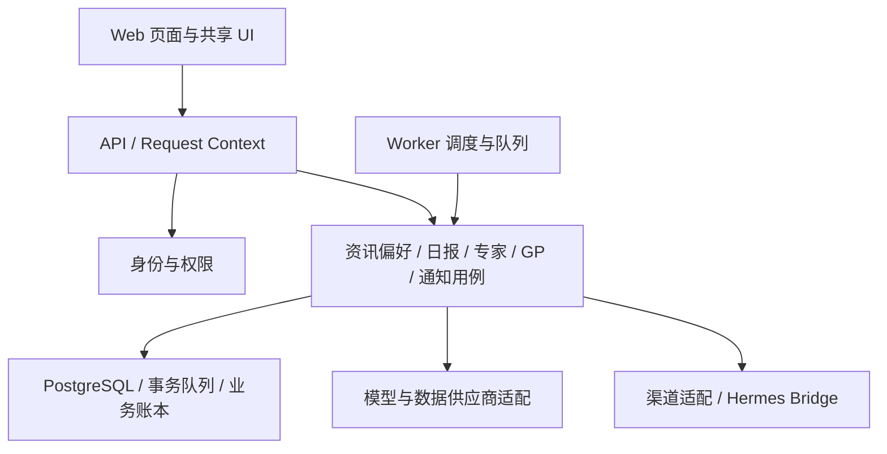

# 全仓架构与实现审查

审查时间：2026-10-22（北京时间）。基线：`origin/main`，提交 `13a89a5ae6008a95773e148114aec2b6dffd162e`，包含 P1、P2、P3 及 PR #3/#4 合并后的实现。

## 结论

**现有技术栈和部署形态可以长期保留，但当前业务边界尚未稳定，不宜直接作为继续扩展的基线。** 对约 20 人的公司内部平台，React Router + Fastify + PostgreSQL + pg-boss，以及 Web/API/Worker 分进程是合理选择。优先完成一次有边界的架构收敛：统一身份、赛道目录、日报快照、专家版本、供应商适配和投递状态，再继续加能力。

发现 **14 项需要处理的问题：7 项 P1、7 项 P2**。其中包括可复现的功能错误，也包括已造成行为分歧的结构问题。P1 应在对应能力上线前解决；P2 应在相关模块继续扩展前解决。P3 开关当前默认关闭，因此发现 P3 缺陷不等于真实微信已发生误发。

“未来完全没有调整”无法保证；现在可以冻结核心契约，让未来新增专家、供应商和消息渠道主要通过适配器扩展，而不反复修改账号、任务、日报和投递表。

本次审查覆盖关键业务路径及其基础设施，不等同于所有代码逐行审计、生产压测或真实渠道验收。未改动业务代码，未启用运行开关，未调用真实付费提供商或发送微信。

## 一、需要保留的基础

| 方面 | 判断 | 依据 |
|---|---|---|
| Web/API/Worker 分进程 | 合理 | SSR 通过 HTTP 访问 API；采集和长任务在 Worker，后续可分别扩容 |
| 单 PostgreSQL + pg-boss | 适合当前规模 | 已支持业务写入和入队共用数据库事务，无须为现有规模增加另一套队列基础设施 |
| 模块化组合 | 可保留并收紧 | `site/modules` 已是组合入口，`contracts`、后端和页面已有可利用的边界 |
| 事实与生成内容分开 | 方向正确 | 原始证据、人工核准、GP 基线及投递回执已有独立数据结构 |
| 前端组件源码可控 | 方向正确 | Radix、Lucide、共享 Button/Input/Card 等已落地，沿用现有主题 Token |
| 模型请求回执 | 有可复用基础 | `providers/receipts.ts` 已实现请求复用、预算串行检查和不明结果处理 |
| 追加式数据库迁移 | 可继续使用 | 当前变更采用新迁移，不依赖修改已发布历史 |
| 合并与上线分开 | 合理 | P3 文档明确真实 MCP、Hermes/iLink、双用户跨日验收尚未完成 |

## 二、P1：对应能力上线前处理

### R01 · 多产业资讯仍经过仅面向 AI 的入口过滤

- 位置：[industry/prompts/prefilter.md](../industry/prompts/prefilter.md#L1)、[analyze.ts](../packages/backend/src/editorial/analyze.ts#L492)。
- 现状：预筛提示词明确要求 AI 相关；普通科技、普通经营等非 AI 内容会得到 `BLOCK`。`runAnalysis` 遇到 BLOCK 就结束，后面的产业赛道结构化不会执行。
- 触发：员工加入光伏、新材料或战略配售信源，其中与 AI 无关但符合业务范围的正文会被入口规则排除。新增赛道标签和信源不能改变这个入口。
- 影响：平台已经提供五大方向的订阅界面，但采集后的处理规则仍限制其覆盖；不能将这解释为单纯的“信源暂时不足”。
- 建议：把产业覆盖规则放到统一的行业配置中，先按平台覆盖领域做相关性判断，再分别处理质量、摘要和赛道；同步检查评分、内容理解和分类提示词中的 AI 专属假设。
- 验收：五类方向分别有包含正文的正例、无关内容负例，以及 AI 剩余类和三个具体 AI 标签的互斥样例；非 AI 产业正例应能走完整个发布链路。
- 证据等级：静态调用链和提示词明确；本次没有调用真实模型评估实际误杀率。

### R02 · 干净 Docker 构建缺少 membership workspace 的安装链接

- 位置：[Dockerfile](../Dockerfile#L12)。
- 现状：`npm ci` 前复制了 apps/packages/industry/site 的 manifests，漏掉 `modules/membership/package.json`。随后直接执行 Web build，`npm prune` 在 build 之后。
- 复现：在临时目录按 Dockerfile 精确复制这些 manifests，执行离线 `npm ci --ignore-scripts` 成功，但未创建 `node_modules/@citic/membership`。再复制会员模块文件后，导入 `@citic/membership/module` 返回 `ERR_MODULE_NOT_FOUND`。
- 影响：已安装完整 workspace 的本地类型检查和 Web build 通过，不代表从 Docker 构建上下文能成功构建。
- 建议：依赖层包含全部参与构建的 workspace manifests；将一次干净镜像构建纳入 CI，确保之后新增模块也在覆盖范围内。
- 验收：全新构建上下文安装、Web build、生产依赖裁剪后，API/Worker/Web 所需模块均能解析并启动。
- 证据等级：实际复现依赖安装和模块解析失败；未运行完整 Docker 镜像构建。

### R03 · `.config/` 会被复制进应用镜像

- 位置：[.dockerignore](../.dockerignore)、[Dockerfile](../Dockerfile#L21)、[AGENTS.md](../AGENTS.md)。
- 现状：仓库约定 `.config/` 存本地/服务器凭据，Git 忽略了该目录，Docker 构建上下文没有忽略；`COPY . .` 会复制它，最终镜像又复制整个 `/app`。
- 触发：在存在该目录的本地或服务器执行推荐的 Docker build。
- 影响：凭据和私人材料进入镜像层、构建缓存及同一个 Web/API/Worker 镜像，违背“Web 不持有后端凭据”的部署边界。
- 建议：明确排除 `.config/`、本地备份和私人资料，镜像只包含运行代码；凭据通过运行时环境或只读 secret 挂载注入。
- 验收：使用合成的标记文件检查构建上下文和最终镜像，确认目录内容不存在；不要用真实密钥做测试。
- 证据等级：构建规则静态确认；未读取真实凭据，未判断历史发布镜像是否已经含有该目录。

### R04 · 专家产物的七天清理遗漏模型回执副本

- 位置：[experts/worker.ts](../modules/membership/experts/worker.ts#L225)、[providers/llm.ts](../packages/backend/src/providers/llm.ts#L218)、[providers/receipts.ts](../packages/backend/src/providers/receipts.ts#L324)、[operations/retention.ts](../packages/backend/src/operations/retention.ts#L32)。
- 现状：专家任务和 artifacts 会删除，但 `chatJson` 的完整模型回答保存在 `receipts.response` 中，包含报告正文和可能引用的用户材料。现有保留任务没有清理这部分回答。
- 影响：用户界面所称“材料和产物保留 7 天”并没有覆盖所有副本；删除业务任务后仍存在完整输出。内置专家的 receipt subject 仅包含企业名哈希，也没有直接绑定用户和任务。
- 建议：为敏感模型回执关联 `user_id/task_id` 和内容过期时间；过期清理响应正文，保留必要的哈希、用量及费用审计字段。明确公开专家定义、用户任务材料、业务产物和备份各自的保留政策。
- 验收：任务过期后跨任务表、产物表、模型回执和缓存搜索合成标记，不能再得到报告正文；费用审计仍可追溯。
- 证据等级：实际写入/清理路径静态核对；本次未运行数据库过期集成测试。

### R05 · 投递前只核对收件权限，不重新核对内容撤回状态

- 位置：[notifications/outbox.ts](../modules/membership/notifications/outbox.ts#L49)、[dispatchOutbox](../modules/membership/notifications/outbox.ts#L133)、[outbox migration](../database/migrations/0126_member_notification_outbox.sql)。
- 现状：生成时把条目拼成 `payload` 文本；发送前只查询用户、绑定和订阅。outbox 没有每条来源的关联记录可供重查。
- 触发：生成后、发送前撤回一条新闻，或把 GP 关系改为 `retracted`；发送器仍会发送旧文本。排队、限流和故障恢复扩大了这个时间窗口。
- 影响：已经明确撤回的内容仍能离开平台，违反 PLAN 的发送前撤回检查。
- 建议：增加 outbox 条目与来源/修订的关联，发送前按当前可见性和核准状态重查，再生成待发文本。对 `unknown` 回执保持现有的不盲目重发原则。
- 验收：在生成与发送之间撤回新闻、撤回 GP、暂停 GP，分别确认相应内容不会发送。
- 证据等级：静态发送路径确认；没有发送真实消息。

### R06 · 原样保存订阅设置也会取消待发消息，并永久消耗去重标记

- 位置：[notifications/routes.ts](../modules/membership/notifications/routes.ts#L35)、[outbox.ts](../modules/membership/notifications/outbox.ts#L74)。
- 现状：`changed=false` 时版本不增加，但更新 outbox 为 `cancelled` 的语句仍然执行。生成器又以同日同版本“存在任何 outbox”作为完成条件；条目在生成时就写入 `member_notification_seen`。
- 触发：09:00 生成日报，派发前用户打开通知设置并原样点击保存。
- 影响：待发消息被取消；本日无法重新生成，次日也会被 `seen` 排除。对于其他明确取消/失败场景，目前同样缺少条目保留或补偿规则。
- 建议：无实际变更时不修改投递记录；区分“预占/已编排”“渠道已受理”“取消/可补偿”，按终态和来源条目维护去重生命周期。不同订阅类型的版本不要无故互相失效。
- 验收：原样保存不影响 pending；关闭再开启、重新绑定、429、已确认未发出的失败都具有明确且可测试的补偿行为；未知结果不自动补发。
- 证据等级：临时 mock 路由复现，观察到 `versionIncrement=0` 和取消 SQL 同时发生；去重后果经调用链确认。

### R07 · GP 重复分页会被当成完整快照，破坏历史基线

- 位置：[gp/sync.ts](../modules/membership/gp/sync.ts#L19)、对照已有 [experts/worker.ts](../modules/membership/experts/worker.ts#L45)。
- 现状：GP 抓取按原始 `fetched` 累加，并在 `fetched >= total` 时判断完整；去重发生在最后，未用唯一条目数检查完整性，也没有重复页保护。
- 复现：提供商两页返回相同 100 条、`total=200`、`has_more=true`，`syncGp` 仍产生 `state=baseline`、`fetched=200`、`unique=100` 的完整快照。
- 影响：历史基线实际缺少一半主体；以后首次读到缺失部分会被标为“新发现”。虽然仍需人工核准，错误基线已经污染审核依据。
- 建议：复用统一分页采集器，检查重复页、稳定身份、计数与结束信号一致性；完整性无法证明时保持不完整，不推进基线。专家和 GP 不应各维护一套此类规则。
- 验收：重复页、部分重叠页、总数变化、无稳定 ID、上限截断、空页但有 hasMore 都不能产生错误的完整基线。
- 证据等级：通过合成提供商响应和 SQL mock 实际调用生产 `syncGp` 复现；未连接真实提供商或数据库。

## 三、P2：继续扩展相关模块前处理

### R08 · 网页日报和微信日报是两套事实生成器

- 位置：[membership/server.ts](../modules/membership/server.ts#L195)、[notifications/outbox.ts](../modules/membership/notifications/outbox.ts#L23)。
- 网页首次 GET 才生成日报，截止点是访问时刻，来源窗口使用 `timeline_at`，返回后保持该日快照；微信在调度时单独读取 publications，使用 `updated_at/visible_after`、绑定时刻、48 小时重叠和另一套去重。
- 同一用户同一天会因首次访问时刻不同看到与微信不同的条目；不访问网站的日期没有网页日报。微信也没有引用 `member_daily_digests` 的版次和偏好快照。后续加入新渠道时这种分歧会继续扩散。
- 建议定义唯一的 `DigestEdition`（用户、当地日期、时区、偏好版本、窗口、修订）和结构化条目。网页读取该版次，渠道渲染该版次；当前可发布状态在阅读/投递时再核对。调度生成与用户主动修订各自有明确契约。
- 验收：相同 edition 在网页和通知具有相同来源集合；晚登录、未登录、跨日停机、变更偏好及撤回有一致结果。

### R09 · 自定义专家向全员显示“可运行”，但禁止其他员工创建任务

- 位置：[experts/routes.ts](../modules/membership/experts/routes.ts#L43)、[执行限制](../modules/membership/experts/routes.ts#L92)。
- 目录列出所有 `available` 专家，创建任务却要求 `owner_id === 当前用户` 或管理员。甲发布的专家在乙的目录可见，乙提交得到 404。
- 此限制混淆了专家定义的编辑权限和任务的执行权限，不符合“校验通过即公开供所有员工使用”。
- 建议单独定义可见性、执行权限、定义修改权限；保持任务/材料/下载归属隔离，允许已公开且符合角色要求的专家被其他员工执行。
- 验收：两用户共享一个已发布专家，各自执行并只能访问自己的任务和产物；blocked/private 定义按明确规则处理。
- 证据等级：临时 mock 路由实际复现目录 available、执行返回 `404 expert_not_found`。

### R10 · ZIP 导入忽略 SKILL frontmatter 中声明的依赖

- 位置：[experts/import.ts](../modules/membership/experts/import.ts#L157)。
- 单文件导入使用 frontmatter 的 tools/skills；ZIP 分支重新建立只来自 manifest 的 `normalizedManifest`，没有合并 frontmatter。`dependencies()` 虽重新解析元数据，也没有将这部分依赖纳入检查。
- 复现：SKILL 声明 `get_direct_investment`，单文件返回缺失依赖；用相同 SKILL 加 `{}` manifest 打包后，缺失依赖变成空数组，可以被发布。
- 建议两种格式先规范化为同一个中间模型，合并依赖并检查冲突、未知字段和所有内容规则，再按执行模式判定可用性。YAML 语法解析优先复用成熟解析器，业务依赖规则由平台控制。
- 验收：同一份 SKILL 在两种导入方式下依赖结果一致；冲突声明、未知字段、工具依赖、其他技能依赖都能被一致阻止。当前仍是文本执行，因此此缺陷不代表已经获得任意 MCP 执行权限。
- 证据等级：直接调用真实解析器、使用合成 ZIP 实际复现。

### R11 · 专家任务恢复的状态更新与重新入队不是原子操作

- 位置：[experts/worker.ts](../modules/membership/experts/worker.ts#L220)、[site/modules/server.ts](../site/modules/server.ts#L20)。
- `recoverExpertTasks` 先将所有过期 running 改为 queued，之后调度器逐条入队。中途崩溃或入队失败时，部分任务会留在 queued，但后续恢复只查 running，可能一直等到七天清理。
- 另外，自动恢复没有执行次数上限，`runExpertTask` 也未在领取时检查次数；界面展示的“最多 3 次”只由手动重试入口部分约束。
- 建议复用已有 `enqueueOn(..., tx)`，让状态迁移与任务入队同事务；为 queued 孤儿、恢复次数、终止原因定义统一处理。取消、停机和失去租约信号应传到外部调用边界。
- 验收：在状态更新和入队之间注入异常、连续重启、达到次数上限、并发取消，任务最终必须进入可解释终态或可靠队列。
- 证据等级：事务边界静态确认；本次未执行真实进程崩溃/数据库故障注入。

### R12 · 微信绑定页面不会获知机器人已经领取绑定码

- 位置：[pages/notifications.tsx](../modules/membership/pages/notifications.tsx#L18)。
- 页面仅在 mount 和自身写操作后刷新数据。用户在微信发码后返回页面，没有轮询或 focus/visibility 刷新；“确认绑定”一直由旧的 `claimed=false` 禁用。过期 challenge 同样会停留在页面状态，继续禁用生成按钮。
- 建议在存在有效 challenge 时有限轮询，回到页面时重新验证，按到期时间刷新状态；绑定完成后停止轮询。复制绑定码复用已有 `lib/clipboard.ts`，展示失败反馈。
- 验收：同一页面不手动刷新即可完成生成→微信领取→确认；到期后能重新生成；微信内置浏览器复制失败有可用回退。
- 证据等级：状态更新和渲染路径静态确认；未做真实手机视觉和交互验收。

### R13 · 开发 SSR 没有建立会员 Cookie 上下文

- 位置：[api.server.ts](../apps/web/app/lib/api.server.ts#L29)、[request-context.server.ts](../apps/web/app/lib/request-context.server.ts)、[server.ts](../apps/web/server.ts#L182)、[vite.config.ts](../apps/web/vite.config.ts)。
- SSR 的 `apiGet` 从 AsyncLocalStorage 读取 Cookie；只有生产 `server.ts` 包裹了 `withRequestCookie`。`react-router dev` 使用 Vite 的处理入口，没有同等包装；依赖 `loadOr404/apiGet` 的资讯 loader 在开发模式无法带入已登录 Cookie。
- 建议把认证读取放进框架支持的 request context/load context，或显式传递 loader Request；开发和生产使用同一份认证上下文契约，避免生产自定义 server 才有的隐含依赖。
- 验收：开发模式和生产模式分别完成登录后直接访问及客户端导航到 `/all`、文章和后台，正常携带同一会话；未登录返回明确登录状态。
- 证据等级：入口和调用链静态核对；本次未启动开发服务器验证 HTTP 行为。

### R14 · CI 没有覆盖核心后端路径，现有架构检查已失败且存在扫描盲区

- 位置：[p3-checks.yml](../.github/workflows/p3-checks.yml#L3)、[architecture.test.ts](../tests/architecture.test.ts#L117)、[p3-db.test.ts](../modules/membership/tests/p3-db.test.ts)。
- 路径触发缺少 `packages/backend/**`、`packages/contracts/**`、`industry/**` 和大部分 `scripts/**`，只改这些核心路径可能不运行质量检查。
- 测试步骤只运行 GP core 和表结构/SQL 约束测试；未运行现有 membership access、expert access 测试，也未覆盖绑定、投递、恢复这些生产函数。
- 本次运行 12 项不依赖数据库的架构检查：9 通过、3 失败。失败项为环境模板遗漏 `XINHUA_MCP_COMPANY_URL`、时间换算散落、圆角不遵循 Token。
- `moduleWeb` 仅匹配 `web.tsx/web/`，漏掉 `pages/*.tsx`。所以 notifications 页面直接写 clipboard 的违规不会被现有检查发现。与之前 Tailwind 扫描遗漏属于同类目录约定漂移。
- 建议建立默认覆盖的基础 CI，按变更领域添加定向业务集成测试；从模块声明统一获取页面范围。分支保护和 required checks 要单独核实，不能由 YAML 或文档推断已经开启。
- 验收：backend-only、industry-only PR 都触发对应检查；网页目录不再漏扫；P1/P2/P3 的用户隔离、事务状态迁移、失效与重试路径有回归测试。

## 四、为减少未来大调整，现在需要确定的六项架构契约

以下是演进设计建议，与上面已经确认的缺陷分开记录。应先写成简短 ADR 并安排迁移，再逐步实施；不要一次重写整个仓库。

### A. 一个用户身份与权限体系

现有 `member_users/member_sessions` 与原 AIHOT `users/admin_sessions` 并存；员工管理员管理会员/GP，原后台仍依赖独立管理员密码或飞书身份。API 启动还强制要求旧后台凭据。当前这是两套管理权限和审计主体，而不是统一账号。

建议以稳定的业务 `user_id` 为主体，角色能力覆盖会员审核、信源管理、模型设置、专家发布和 GP 核准；原后台通过适配层复用同一 principal。保留或引入成熟认证实现时，业务表依然引用稳定主体 ID，使认证提供商可以更换。补齐禁用用户、会话撤销、密码重置和管理操作审计。

浏览器中的收藏、已读、搜索历史目前使用全站 `aihot-*` 存储键，未按用户隔离；共享浏览器换账号时会继承上一用户的数据。统一身份时同时明确这些状态属于设备还是个人，按账号隔离并处理退出清理。

### B. 一个赛道目录，标签 ID 与显示名称分离

当前目录重复存在于 `industry/taxonomy.ts`、membership catalog、提示词和 GP 页面；订阅和文章匹配直接使用中文名称字符串。公共新增标签没有一级方向，GP 的 `GP_TAGS` 又只取静态预置目录，因此新增赛道不能自然参与 GP 匹配。

建议建立 `directions/tags/tag_aliases`，使用稳定 `tag_id`，保留显示名、所属方向、适用新闻/企业分类范围、状态、版本和合并映射。先建立与现有字符串的兼容映射，再迁移订阅、分类和匹配，避免重命名让历史数据断链。AI 三个具体标签与剩余类的规则应确定性校验，不能只写进提示词。

### C. 一个可复用的日报领域服务

解决 R08。将 HTTP 路由中的生成 SQL移到日报服务，保存版次、条目和来源身份。用户偏好、时间窗口和修订规则由服务统一负责；网页、微信、未来邮件只负责各自呈现和传输。

同时明确用户当天首次访问、尚未生成、修改兴趣、重生成和历史撤回时的行为。历史快照用于追溯；对外呈现需要遵守当前撤回政策。

### D. 专家定义版本与任务运行分离

当前任务只引用 `expert_slug`，内置专家定义在读取目录时 upsert；没有不可变的 expert version/hash 绑定。自定义专家通过每次新建 slug 绕开覆盖，但没有稳定的专家与版本关系。

建议拆出 `ExpertDefinition` 与不可变 `ExpertVersion`，任务绑定确切版本、输入 schema、工具权限、预算策略和输出 schema。运行器至少明确区分 `text_only` 与经过平台批准的工作流，当前文本执行限制保持可见。未来增加 PDF/XLSX 等产物时通过 renderer 接口扩展，产物存储和访问控制保持独立。

当前 Markdown 小产物存 PostgreSQL 对 20 人规模足够；等实际出现大文件再迁移到对象存储。提前保留 artifact 的存储引用、哈希、类型和 expires_at 即可。

### E. 统一供应商适配与调用账本

目前 GP 直接依赖 `experts/xinhua.ts` 和 `experts/data.ts`，并复制分页规则，R07 已体现重复实现的后果。供应商 ID、来源字段、分页及错误语义应该由适配层负责。

建议定义企业查询、唯一身份确认、投资快照采集等能力接口，返回标准化事实及完整的来源/字段语义/完整性证明。业务主体使用内部 ID，供应商 ID 作为有 namespace 的映射；更换新华财经、悟道或其他来源时，业务基线和审批记录保持可解释。

模型请求已有 receipts/budgets 基础，可以扩展；当前新华财经 MCP 调用直接 `client.callTool`，未进入同样的用量/预算账本。统一记录主体、任务/批次、工具、参数哈希、调用结果、费用或未知费用、超时和预算，不存不必要的敏感正文。

### F. 统一业务状态迁移与投递补偿规则

事务 outbox、队列、租约、已受理、未知、取消的语义需要固定。持久化“哪个版次的哪些条目发给哪个绑定版本”，区分生成/预占与实际渠道受理；unknown 通过桥接幂等查询或人工核对解决。

当前 `accepted` 只代表渠道受理，文档这一点是正确的；不能把它改称送达。Hermes sidecar 仍未实现，应先验证其最小能力契约：真实收件人身份、幂等持久化、错误分类、状态查询，再根据事实确定最终补偿策略。这个外部契约是目前最大的尚未消除的不确定性。

## 五、建议的代码组织与前端演进

建议采用模块化单体：继续保留三个运行进程和一个数据库，各领域独立拥有用例和数据写入口。



- `site` 作为配置与组合入口；底层 contracts 避免反向读取站点运行实现。把实际跨域接口和 DTO 放到 contracts，平台服务通过依赖注入或明确函数参数组合。
- 按身份、兴趣、日报、专家、GP、通知拆分现有 membership 的用例层。路由只做解析、认证、调用和响应；采集/模型/投递不能由页面或路由自行拼接业务规则。
- 将共享 UI 从运行中的 `@aihot/web` 包依赖中逐步抽出，先保留兼容 re-export。模块页面依赖 UI/contracts，Web 壳加载模块页面，减少双向耦合。
- 统一 Button、Input、Select、反馈状态、间距、页面容器及图标入口；现有首页仍有硬编码 `text-red-700`、不存在的 `text-ink-muted` Token 和不在圆角表上的样式。原 `components/ui`、`member-ui`、后台 UI 应有一个明确收敛方向。
- Radix primitives 和 Lucide 可以继续保留。没有业务需要时不用安装完整 Kumo、Motion 扩展、拖拽或状态库；如选 shadcn Nova，应逐个组件适配现有 Token，而非再建一套并行主题。
- 前端服务端数据统一采用 React Router loader/action/fetcher，或明确的一套客户端查询方案。当前大量页面重复 `useEffect + fetch + boolean busy`，错误分类、取消请求和重新验证行为已出现分歧。组件局部状态继续用 React；只有确切的跨组件客户端状态再使用 Zustand。
- 复用接口 schema 和错误枚举。当前 TSX 自行声明 DTO，再 `as` 强转 JSON，构建无法发现真实 API 字段和错误语义变化。补齐 membership 对 `fastify`、`cheerio`、`zod`、contracts 等直接导入的依赖声明，避免再次依赖 workspace hoisting。
- 专家提交每次点击都会生成新 idempotency key；请求成功但响应丢失后重试会变成新任务。按一次业务提交保留同一 key，并由服务端校验同 key 的输入摘要。GP 审核列表需分页和按待核状态过滤，避免固定 300 条结果和大量复选框成为实际使用瓶颈。

## 六、实施顺序与完成标准

| 阶段 | 范围 | 完成标准 |
|---|---|---|
| 1. 固定正确性与部署门槛 | R01–R07，补关键回归；修复 CI 触发与目录扫描 | 干净镜像构建通过；非 AI 产业链路可用；七天清理覆盖副本；撤回和原样保存不误发/丢消息；重复页不推进基线 |
| 2. 固定核心领域契约 | 身份、标签 ID、统一 DigestEdition、ExpertVersion、供应商与渠道接口 | ADR 和兼容迁移明确；所有旧入口经过同一套用例；跨用户/跨渠道/重跑结果一致 |
| 3. 前端与运行一致性 | R09/R10/R12/R13，统一 UI 和数据读取，完善恢复 R11 | 真实登录、跨用户共享专家、导入、主体确认、绑定与管理流程可完成；开发和生产行为一致 |
| 4. 外部联调和 P4 | 真实新华财经、模型、Hermes sidecar、双用户跨日、备份恢复 | 依据 P3/P4 既定验收记录结果；数据库、镜像、配置可恢复；不以代码合并代替渠道已打通 |

以小 PR 顺序推进：先修已确认缺陷，再拆出服务与契约，最后迁移调用方。新表和新接口先兼容旧读取，数据回填验证后再移除旧路径，保留可回退窗口。无需为了此次审查迁移 React/Fastify/PostgreSQL 或拆分为微服务。

## 七、本次验证记录与限制

| 检查 | 结果 |
|---|---|
| `npm run typecheck` | 通过，针对本次 main 基线重新执行 |
| `npm run build -w @aihot/web` | 通过，针对本次 main 基线重新执行；不等同于 Docker build |
| 会员独立测试：experts / interests-state / gp-core | 16 项通过 |
| 架构检查，排除需数据库的表字段使用检查 | 12 项运行：9 通过、3 失败；失败见 R14 |
| ZIP 依赖对比 | 复现 R10：单文件有缺失依赖，ZIP 无缺失依赖 |
| GP 重复页（生产函数 + 提供商/SQL mock） | 复现 R07：100 个唯一主体错误记录为 total=200 的完整 baseline |
| 路由 mock | 复现 R09 的共享专家执行 404、R06 的原样保存取消消息 |
| Docker manifests 依赖层模拟 | `npm ci` 成功但 membership 无链接；后续模块导入 `ERR_MODULE_NOT_FOUND` |

可重复的仓库内命令：

```sh
npm run typecheck
npm run build -w @aihot/web
node --import ./tests/standalone.ts --test modules/membership/tests/experts.standalone.test.ts modules/membership/tests/interests-state.standalone.test.ts modules/membership/tests/gp-core.standalone.test.ts
node --import ./tests/standalone.ts --test --test-skip-pattern='every table and column' tests/architecture.test.ts
```

临时复现只使用合成数据，未写入仓库测试体系；mock 结果用于证明分支行为，不作为数据库事务或真实供应商协议的验收。没有运行全量测试、完整 Docker build、真实 PostgreSQL 集成、浏览器视觉回归、真实提供商调用、微信投递或生产恢复。未核实 GitHub 分支保护。所有这些限制均应保留在后续交付记录中。

## 八、R01–R14 修复跟踪

本报告列出的 R01–R14 已在[修复记录](logs/2026-10-22-repo-review-remediation.md)对应实现和回归覆盖，并已随 [PR #6](https://github.com/JoeLiaoo/newsfeed-fixedagent/pull/6) 合并至 `main`（合并提交 `2c98e53`）。PR #6 合并前还修复了通知长消息分片和退订／解绑竞态，详见同一日志。以上修复没有把报告中的长期架构建议 A–F 标记为已完成，也不改变 P0–P4 的验收状态。
